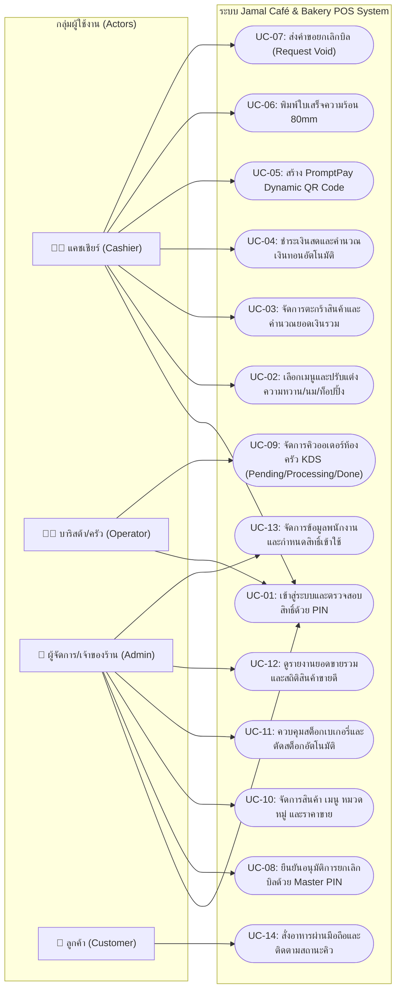
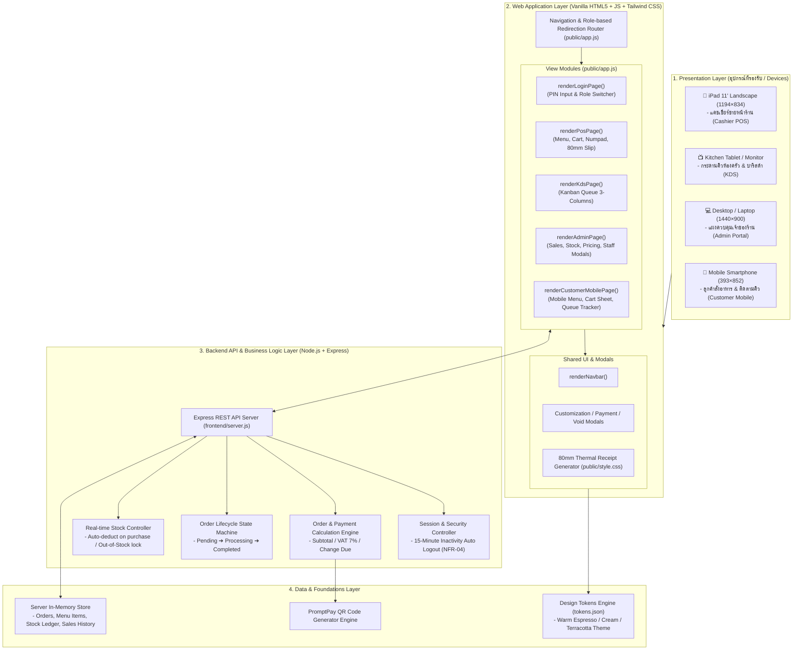
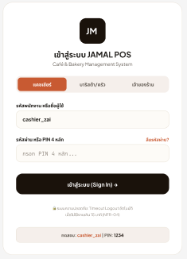
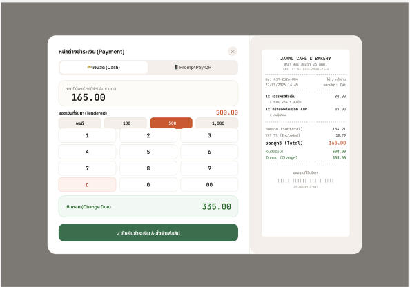
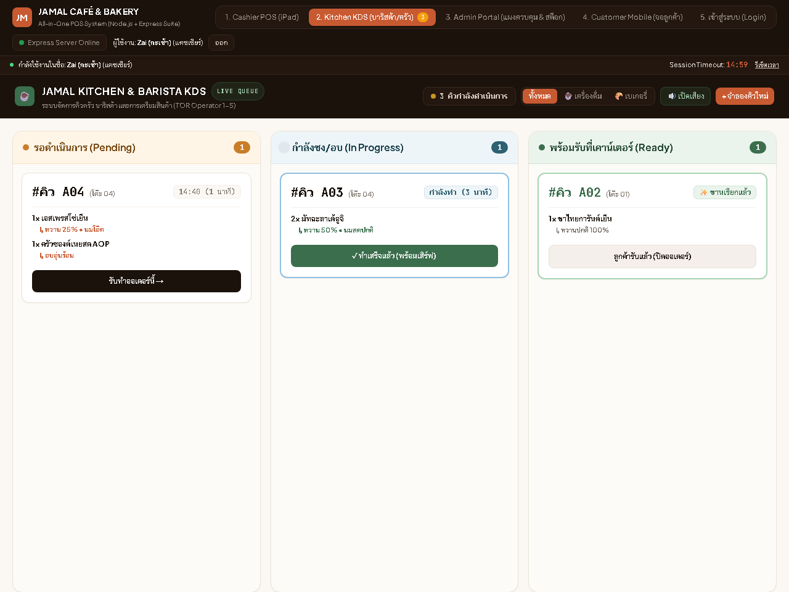

## รายชื่อสมาชิกกลุ่ม (Team Members)

| ลำดับ | รหัสนิสิต | ชื่อ - นามสกุล | GitHub Username |
| :---: | :---: | :--- | :--- |
| 1 | 68102010210 | นาย พิสิษฐ์ เสนีวงศ์ ณ อยุธยา | @AkashiZai |
| 2 | 68102010209 | นาย พิชยุตม์ เจียวพงษ์พิพัฒน์ | @Ctrl-Pichayut |
| 3 | 68102010203 | นาย ธราเทพ ศรีมานนท์ | @203Tharathep |
| 4 | 68102010190 | นาย ก้องเกียรติ อมรธรรมคุณ| @Kizizi123123 |
---
 
# POS ร้านคาเฟ่และเบเกอรี่ (Café & Bakery POS Web Application)
 
---
## 1. ที่มาของปัญหาและความสำคัญ (Problem Statement & Significance)
ในปัจจุบันธุรกิจร้านกาแฟและเบเกอรี่ขนาดย่อม (SMEs) มีการเติบโตขึ้นอย่างต่อเนื่อง แต่ร้านค้าส่วนใหญ่ยังประสบปัญหาในการบริหารจัดการหน้าร้าน ดังนี้:
1. **ความล่าช้าและความผิดพลาดในการรับออเดอร์**: การใช้กระดาษจดหรือเครื่องคิดเลขทำให้เกิดความผิดพลาดได้ง่าย โดยเฉพาะเมนูที่มีรายละเอียดซับซ้อน เช่น ระดับความหวาน ท็อปปิ้งเสริม
2. **ปัญหาการจัดการสต็อกสินค้าเบเกอรี่**: สินค้าประเภทเบเกอรี่มีอายุสั้นและรับมาจำนวนจำกัดต่อวัน การไม่มีระบบตัดสต็อกแบบ Real-time ส่งผลให้รับออเดอร์สินค้าที่หมดแล้ว เกิดความไม่พึงพอใจแก่ลูกค้า
3. **ความยุ่งยากในการสรุปบัญชีและรายงานยอดขาย**: เจ้าของร้านต้องเสียเวลาหลายชั่วโมงหลังปิดร้านเพื่อกระทบยอดเงินสดกับสลิปโอนเงิน และขาดข้อมูลสถิติเมนูขายดีในการวางแผนสต็อกวัตถุดิบล่วงหน้า

ทางกลุ่มจึงได้พัฒนา **Web-based Point of Sale (POS)** ขึ้น เพื่อช่วยให้การรับออเดอร์สะดวกรวดเร็ว ควบคุมสต็อกได้อัตโนมัติ และสรุปยอดขายได้แบบ Real-time ผ่านอุปกรณ์แท็บเล็ตหรือคอมพิวเตอร์

---

## 2. จุดประสงค์ของโครงการและประโยชน์ที่คาดว่าจะได้รับ (Objectives & Expected Benefits)

### จุดประสงค์ (Objectives)
1. เพื่อพัฒนาระบบคิดเงินและรับออเดอร์หน้าร้านที่ใช้งานง่าย รองรับตัวเลือกเมนูเครื่องดื่มและเบเกอรี่
2. เพื่อพัฒนาระบบตัดสต็อกเบเกอรี่อัตโนมัติเมื่อเกิดการขาย และแจ้งเตือนสินค้าใกล้หมด
3. เพื่อพัฒนาระบบคำนวณเงินทอนและรองรับการชำระเงินผ่าน QR Code PromptPay
4. เพื่อพัฒนาระบบสรุปยอดขายและแสดงแดชบอร์ดสถิติสินค้าขายดีสำหรับเจ้าของร้าน

### ประโยชน์ที่คาดว่าจะได้รับ (Expected Benefits)
1. **ลดเวลาและข้อผิดพลาด**: พนักงานคิดเงินได้เร็วขึ้นภายใน 15 วินาทีต่อบิล และลดปัญหาการทำออเดอร์ผิดพลาด
2. **ควบคุมสต็อกได้แม่นยำ**: ทราบจำนวนสต็อกเบเกอรี่คงเหลือแบบ Real-time ลดปัญหาสินค้าค้างสต็อกหรือของหมด
3. **ลดเวลาทำบัญชีประจำวัน**: สรุปยอดขายรายวันและแยกประเภทเงินสด/โอนเงินได้ทันทีหลังปิดร้าน
4. **เพิ่มประสิทธิภาพการวางแผนธุรกิจ**: เจ้าของร้านนำข้อมูลเมนูขายดีไปวางแผนการสั่งวัตถุดิบได้อย่างคุ้มค่า

---

## 3. ขอบเขตของโครงการ (Project Scope)

### สิ่งที่ระบบครอบคลุม (In-Scope)
* **การยืนยันตัวตนและสิทธิ์**: แยกสิทธิ์ระหว่าง แคชเชียร์ (Cashier) และ เจ้าของร้าน (Admin)
* **การจัดการเมนูสินค้า**: เพิ่ม/แก้ไข/ลบเมนู จัดหมวดหมู่ กำหนดตัวเลือก (ความหวาน, ท็อปปิ้ง)
* **ระบบขายหน้าร้าน (POS)**: เลือกเมนู คำนวณราคารวม ภาษี/ส่วนลด และส่งออเดอร์
* **การตัดสต็อก**: ตัดสต็อกสินค้าเบเกอรี่อัตโนมัติตามจำนวนที่ขาย
* **การชำระเงิน**: รองรับเงินสด (พร้อมคำนวณเงินทอน) และสร้าง QR Code PromptPay
* **ใบเสร็จ**: แสดงตัวอย่างใบเสร็จ (Receipt Preview) และสั่งพิมพ์สลิปขนาด 80mm
* **รายงานสรุป**: Dashboard ยอดขายประจำวัน, สถิติเมนูขายดี Top 5, ยอดแยกตามประเภทชำระเงิน

### สิ่งที่ยังไม่ครอบคลุมในเวอร์ชันนี้ (Out-of-Scope)
* การเชื่อมต่อกับเครื่องรูดบัตรเครดิต (EDC) โดยตรง
* ระบบสมาชิกสะสมแต้มขั้นสูง (Loyalty Point System)
* ระบบส่งออเดอร์เข้าจอห้องครัวอัตโนมัติ (Kitchen Display System - KDS)
* การเชื่อมต่อ API ธนาคารเพื่อตรวจสอบสลิปแบบอัตโนมัติ (ใช้การยืนยันยอดด้วยพนักงาน)

---

## 4. ความต้องการของระบบและคลิปการสอบถาม (System Requirements)

### 4.1 Functional Requirements (FR)
* **FR-01 (Authentication)**: ระบบสามารถเข้าสู่ระบบและแยกสิทธิ์การใช้งานระหว่าง Admin และ Cashier ได้
* **FR-02 (Menu Management)**: Admin สามารถเพิ่ม ลบ แก้ไข รายการสินค้า หมวดหมู่ ราคา และตัวเลือกสินค้าได้
* **FR-03 (Inventory Tracking)**: ระบบสามารถตัดสต็อกสินค้าเบเกอรี่อัตโนมัติเมื่อชำระเงินสำเร็จ และแสดงสถานะ "Out of Stock" เมื่อของหมด
* **FR-04 (Order Processing)**: Cashier สามารถเลือกรายการสินค้า เพิ่ม/ลดจำนวน กำหนดระดับความหวานและท็อปปิ้งได้
* **FR-05 (Payment Calculation)**: ระบบสามารถคำนวณยอดเงินรวม คำนวณเงินทอนสำหรับเงินสด และแสดง QR Code PromptPay พร้อมยอดเงินรวมได้
* **FR-06 (Receipt Generation)**: ระบบสามารถสร้างใบเสร็จรับเงิน และสั่งพิมพ์ผ่านเครื่องพิมพ์สลิปความร้อน (80mm Thermal Printer) ได้
* **FR-07 (Void Protection)**: การยกเลิกบิลหรือคืนเงิน (Void/Refund) ต้องใช้รหัสผ่านของ Admin ในการอนุมัติเท่านั้น
* **FR-08 (Sales Reporting)**: Admin สามารถดูรายงานยอดขายรวมประจำวัน ยอดขายแยกตามวิธีชำระเงิน และอันดับสินค้าขายดีได้

### 4.2 Non-Functional Requirements (NFR)
* **NFR-01 (Performance)**: หน้าจอขาย (POS) ต้องประมวลผลและตอบสนองการกดเลือกรายการได้ภายในเวลาไม่เกิน 1 วินาที
* **NFR-02 (Usability)**: หน้าจอ User Interface ต้องออกแบบให้มีปุ่มสัมผัสขนาดใหญ่ เหมาะสำหรับการใช้งานบนหน้าจอสัมผัส (Touchscreen/iPad)
* **NFR-03 (Reliability)**: ระบบต้องมีความเสถียร รองรับการใช้งานต่อเนื่องได้ตลอดทั้งวันโดยไม่มีอาการหน้าจอค้าง (Freeze)
* **NFR-04 (Security)**: มีระบบ Timeout Logout อัตโนมัติหากไม่มีการใช้งานเกิน 15 นาที เพื่อป้องกันการเข้าถึงข้อมูลโดยไม่ได้รับอนุญาต
* **NFR-05 (Portability)**: ระบบต้องรองรับการแสดงผลแบบ Responsive บน Web Browser ชั้นนำ (Google Chrome, Safari) บนแท็บเล็ตและคอมพิวเตอร์

---

## 5. ข้อกำหนดขอบเขตงาน (Terms of Reference - TOR)

# Front end spec 
1. มีหน้า Login / Register 
2. มีระบบ Authentication และ Role-based Access 
3. รองรับการใช้งานบน iOS, Android, Windows 
4. รองรับ Responsive Web Design 
# Front end spec for admin 
1. มีหน้าต่าง Dashboard แสดงข้อมูลภาพรวม เช่น ยอดขาย จำนวนบิล และสินค้าขายดี 
2. สามารถจัดการข้อมูลสินค้า เมนู ราคา และหมวดหมู่ 
3. สามารถจัดการข้อมูลผู้ใช้งานและสิทธิ์ 
4. สามารถดูประวัติรายการขายย้อนหลังและรายงานยอดขายได้ 
5. สามารถจัดการสต็อกและตรวจสอบสินค้าใกล้หมดได้ 
# Front end spec for user 
1. สามารถดูรายการสินค้าและรายละเอียดสินค้าได้ 
2. สามารถเลือกสินค้าและกำหนดจำนวนได้ 
3. สามารถเลือก Option ของสินค้า เช่น ความหวาน ท็อปปิ้ง และชนิดนม 
4. สามารถตรวจสอบรายการใน Cart และยอดรวมได้ 
5. สามารถตรวจสอบสถานะรายการสั่งซื้อและการชำระเงินได้
# Front end spec for operator 
1. มีหน้าจอเฉพาะสำหรับพนักงานในการจัดการรายการ 
2. สามารถดูรายการที่เข้ามาแบบ Real-time ได้ 
3. สามารถเปลี่ยนสถานะรายการ เช่น Pending, Processing, Completed 
4. มีระบบแจ้งเตือนเมื่อมีรายการใหม่หรือรายการมีการเปลี่ยนแปลง 
5. สามารถตรวจสอบรายละเอียดและประวัติรายการที่ดำเนินการแล้วได้ 

---

## 6. กระบวนการทำงานและเครื่องมือที่ใช้ (Process, Methods & Tools)
โครงการนี้ใช้ระเบียบวิธี **Agile Framework (Scrum)** ในการดำเนินงาน โดยแบ่งรอบการทำงานออกเป็น 5 Sprints (Sprint ละ 1 สัปดาห์) โดยใน Phase 2 (Sprint 2) ได้มีการขยายและกำหนดระเบียบวิธีปฏิบัติงานและเครื่องมือเพิ่มเติมอย่างเป็นรูปธรรม ดังนี้:

### 6.1 การติดตามสถานะของโปรเจกต์ (Project Tracking & Management)
* **เครื่องมือที่ใช้**: **GitHub Projects (Kanban Board)** และ **GitHub Issues / Milestones**
* **วิธีการดำเนินงาน**:
  * แปลง Requirement และข้อกำหนด TOR ออกเป็น User Stories และ Work Items ทั้งหมด 10 Issues ผูกกับ Milestone ของแต่ละ Sprint (Sprint 1 ถึง Sprint 4) ไว้อย่างชัดเจน
  * ใช้ Kanban Board ติดตามสถานะของงานผ่าน 4 คอลัมน์หลัก:
    * `Todo`: งานที่วางแผนไว้ใน Sprint Backlog แต่ยังไม่ได้เริ่มลงมือทำ
    * `In Progress`: งานที่กำลังดำเนินการพัฒนาโค้ดหรือออกแบบ UI ใน Figma
    * `Review / In PR`: งานที่พัฒนาเสร็จแล้ว รอการตรวจสอบโค้ด (Code Review) และการทดสอบ UI ผ่าน Pull Request
    * `Done`: งานที่ผ่านการทดสอบและ Merge รวมเข้ากิ่งหลัก (`main`) เรียบร้อยแล้ว
  * มีการติดป้ายกำกับ (Labels) ชัดเจน เช่น `Feature`, `documentation`, `Priority High`, `Priority Low` พร้อมระบุ Assignee ผู้รับผิดชอบครบทุกคน

### 6.2 ความถี่และพิธีกรรมของการทำ Scrum (Scrum Cadence & Ceremonies)
ทีมงานมีการจัดประชุม Scrum อย่างสม่ำเสมอตลอด Sprint 2 เพื่อให้งานส่งมอบได้ตรงเวลาและมีคุณภาพ:
1. **Sprint Planning (สัปดาห์ละ 1 ครั้ง)**: ประชุมต้นสัปดาห์เพื่อวิเคราะห์ User Stories, แตก Task ย่อย, ประเมิน Story Points และกำหนด Definition of Done (DoD) ของ Sprint
2. **Daily Standup (วันเว้นวัน หรือ 3 ครั้ง/สัปดาห์ ผ่าน Discord/Google Meet)**: ประชุมสั้นๆ 10-15 นาที โดยสมาชิกทุกคนตอบ 3 คำถามหลัก:
   * เมื่อวานทำอะไรเสร็จไปแล้วบ้าง?
   * วันนี้จะทำอะไรต่อ?
   * มีปัญหาหรืออุปสรรคใดที่ติดขัดหรือไม่ (Blockers)?
3. **Sprint Review & Demo (สิ้นสุด Sprint)**: นำชิ้นงาน Figma Prototype และ Web Application มาทดสอบการคลิกและจำลองเหตุการณ์ร่วมกัน
4. **Sprint Retrospective (สิ้นสุด Sprint ละ 1 ครั้ง)**: ประชุมทบทวนผลการทำงาน (What went well, What could be improved, Action items) พร้อมบันทึกวิดีโอสรุป

### 6.3 มาตรฐานการตั้งชื่อ Branch (Git Branching Strategy)
ทีมใช้กลยุทธ์ **Feature Branch Workflow** โดยแตกกิ่งย่อยออกจาก `main` ตามประเภทงานและหมายเลขโมดูล:
* **รูปแบบการตั้งชื่อ (Naming Format)**: `<type>/<scope>-<short-description>` หรือ `feat/<part-number>-<feature>`
* **Prefix ที่ใช้**:
  * `feat/`: สำหรับการพัฒนาฟีเจอร์ใหม่ เช่น `feat/part1-auth-login`, `feat/part2-cashier-pos`, `feat/figma-page`
  * `fix/`: สำหรับการแก้บั๊ก เช่น `fix/navbar-styling`, `fix/receipt-calculation`
  * `docs/`: สำหรับงานเขียนเอกสาร เช่น `docs/update-readme-phase2`, `docs/system-workflow`
* **ข้อกำหนด**: สมาชิกจะไม่ Push โค้ดตรงเข้ากิ่ง `main` หากยังไม่ผ่านการทดสอบเบื้องต้น (Self-Test) และเมื่อฟีเจอร์เสร็จสมบูรณ์จะต้องเปิด Pull Request เพื่อตรวจสอบก่อนทำการ Merge

### 6.4 ช่องทางและแนวทางการสื่อสารในช่วงการทำโปรเจกต์ (Team Communication Channels)
ทีมงานผสมผสานการสื่อสารทั้งแบบ Synchronous (แบบเรียลไทม์) และ Asynchronous (แบบต่างเวลา) ดังนี้:
1. **Discord (Voice & Screen Sharing)**: ใช้สำหรับการจัดประชุม Standup, Live Pair-Programming, และการแชร์หน้าจอเพื่อทดสอบ Prototype บน Figma ร่วมกัน
2. **LINE Group**: ใช้สำหรับการส่งข้อความแจ้งเตือนด่วน, นัดหมายเวลาประชุม, และแชร์ลิงก์ไฟล์งานสำคัญ
3. **GitHub Pull Requests & Discussions**: ใช้สำหรับการทำ Code Review, คอมเมนต์ติชมโค้ด, ตรวจสอบ Diff และอนุมัติการ Merge เข้าสู่กิ่งหลัก
4. **Figma Comments**: ใช้เครื่องมือ Comment ใน Figma เพื่อปักหมุดจุดที่ต้องการปรับปรุง UI, ตำแหน่งปุ่ม และขนาดตัวอักษรระหว่างฝ่ายออกแบบและฝ่ายพัฒนา

---

## 7. สรุปขั้นตอนการเก็บรวบรวมและคลิปการสอบถาม Requirement (Requirement Collection Summary & Video)

คลิบวิดีโอ Requirement https://youtu.be/mrEzVA0Pjyg

1. **การกำหนดกลุ่มเป้าหมาย**: เลือกผู้ประกอบการร้านคาเฟ่และเบเกอรี่ขนาดย่อมเป็นผู้ให้ความต้องการ
2. **การเตรียมชุดคำถาม**: จัดทำคำถามสัมภาษณ์ 6 หมวดหมู่ (บริบทและปัญหา, สิทธิ์ผู้ใช้, สินค้าและสต็อก, การชำระเงิน, รายงาน, และขอบเขตทางเทคนิค)
3. **การสัมภาษณ์และบันทึกข้อมูล**: สัมภาษณ์ผ่านทางออนไลน์และจดบันทึกประเด็นปัญหา (Pain Points) หลัก ได้แก่ การคิดเงินช้า, สต็อกเบเกอรี่ไม่ตรง, และการสรุปยอดขายยาก
4. **การวิเคราะห์และจัดกลุ่ม Requirement**: นำผลสัมภาษณ์มาคัดกรอง แยกเป็น Functional / Non-Functional Requirements และกำหนดขอบเขต In-Scope / Out-of-Scope ร่วมกันในทีม

---


## 8. สรุปผลการประชุมทบทวนการทำงาน (Sprint 1 Retrospective)

คลิปวิดีโอสรุปการประชุม Retrospective https://youtu.be/IORRQBUFmWI

เมื่อสิ้นสุดการทำงานใน Sprint 1 (Due date: 9 กันยายน 2569) ทีมงานได้จัดประชุมทบทวนการทำงานร่วมกัน (Retrospective) สรุปประเด็นสำคัญจากที่ประชุมได้ดังนี้

### 1. สิ่งที่ทำได้ดี (What went well)

ทีมงานทุกคนมีความเข้าใจในปัญหาของร้านคาเฟ่ตรงกัน ทำให้การกำหนดขอบเขตงาน (Scope) ทำได้ชัดเจนตั้งแต่ต้น 
การกระจายงานเขียนเอกสารและการกำหนด User Story บน GitHub มีการแบ่งหน้าที่กันอย่างชัดเจน 

### 2. สิ่งที่ควรปรับปรุง (What could be improved)

ควรระบุขนาดและหน่วยของสต็อกสินค้าให้ละเอียดมากขึ้นในสปรินต์ถัดไป 
การออกแบบ UI ใน Figma ควรเริ่มทำคู่ขนานไปพร้อมกับการพัฒนา Backend API ทันทีตั้งแต่ Sprint 2 

### 3. สิ่งที่ต้องทำต่อไป (Next Steps / Action Items)

เริ่มต้นพัฒนาโครงสร้างโปรเจกต์ (Project Setup) และทำหน้า Login เป็นลำดับแรกใน Sprint 2 ตาม Backlog ที่วางไว้

---


## 9. ภาพหน้าจอการทำงานบน GitHub (Screenshots & Explanations)
9.1 Product Backlog (Work Items & User Stories)


คำอธิบาย: หน้า GitHub Issues แสดงรายการ Work Items และ User Stories ทั้งหมดของโปรเจกต์ (รวม 10 Issues) ครอบคลุมทั้งงานเอกสาร (label documentation) และฟีเจอร์ของระบบ (label Feature) โดยแต่ละรายการมีการติด Priority (Priority High / Priority Low) และผูกกับ Milestone ของแต่ละ Sprint (Sprint1–Sprint4) ไว้อย่างชัดเจน

9.2 Sprint Backlog & Milestones


คำอธิบาย: หน้า GitHub Milestones แสดงการแบ่งงานออกเป็น 4 Sprint (Sprint1–Sprint4) แต่ละ Sprint มีการกำหนด Due Date และจำนวน Issue ที่ต้องทำให้เสร็จอย่างชัดเจน เช่น Sprint 1 (Due 9 ก.ย. 2569) มี 4 Issues ครอบคลุมงาน Requirement, TOR, README และ Retrospective ส่วน Sprint 2–4 เป็น User Story ของฟีเจอร์หลักของระบบ POS ตามลำดับ

9.3 ตัวอย่างรายละเอียดของ Issue (Issue Detail)


คำอธิบาย: ตัวอย่างรายละเอียดของ Issue #5 "[User Story] User Authentication and Role-based Access" แสดงโครงสร้าง User Story ในรูปแบบ "As a Staff/Owner, I want to login with my credentials so that I can access the system with my assigned role permissions." พร้อม Assignee (203Tharathep), Label (Feature, Priority High), Milestone (Sprint2) และสถานะบน Project Board (Todo)


---

## 10. สรุปการเปลี่ยนแปลง Requirement และขอบเขตงานใน Phase 2 (Requirement & Scope Changes)

### 10.1 สิ่งที่เปลี่ยนแปลงจากรายงาน Phase 1 และเหตุผลที่เปลี่ยน (Changes from Phase 1)
จากการดำเนินงานและทบทวนความต้องการร่วมกันในทีมช่วง Sprint 2 ทีมงานได้มีการปรับปรุงและขยายขอบเขตงานจากรายงาน Phase 1 ดังต่อไปนี้:

1. **การขยายขอบเขตหน้าจอระบบ (Scope & Deliverables Expansion)**:
   * *เดิม (Phase 1)*: วางแผนพัฒนาเฉพาะ 2 หน้าจอหลัก คือ หน้าจอเข้าสู่ระบบ (Login) และหน้าจอขายหน้าร้าน (Cashier POS)
   * *สิ่งที่เปลี่ยน (Phase 2)*: พัฒนาและออกแบบหน้าจอเพิ่มเป็น 5 โมดูลระบบแบบครบวงจร ได้แก่ หน้าเข้าสู่ระบบ (Login), หน้าจอขายหน้าร้าน (Cashier POS), หน้าจอกระดานคิวห้องครัวและบาริสต้า (Kitchen KDS), หน้าจอแผงควบคุมเจ้าของร้านและสต็อก (Admin Portal), และหน้าจอลูกค้าสั่งอาหารผ่านมือถือ (Customer Mobile)
   * *เหตุผลที่เปลี่ยน*: เพื่อให้เห็น Flow การทำงานแบบบูรณาการตั้งแต่ต้นน้ำถึงปลายน้ำ (End-to-End Workflow) โดยออเดอร์ที่แคชเชียร์รับหน้าร้านจะถูกส่งต่อไปยังห้องครัวทันที และข้อมูลสต็อกสินค้าจะถูกตัดและรายงานขึ้นแดชบอร์ดของผู้จัดการแบบ Real-time
2. **การนำระบบ Design Tokens และ UI Standardization มาใช้**:
   * *เดิม (Phase 1)*: การออกแบบยังไม่ได้กำหนดโทนสีและสเปกการจัดวางที่แน่นอน
   * *สิ่งที่เปลี่ยน (Phase 2)*: จัดทำไฟล์ `tokens.json` และคู่มือ `FIGMA_SPEC.md` โดยกำหนด Palette สี Artisanal Warm Modernist (Dark Espresso, Warm Cream, Terracotta, Sage Matcha), Spacing, Border Radius และ Typography (Plus Jakarta Sans, Sarabun)
   * *เหตุผลที่เปลี่ยน*: เพื่อควบคุมทิศทางการออกแบบให้เป็นเอกภาพ (Consistency) ป้องกันความคลาดเคลื่อนเมื่อสมาชิกแต่ละคนแยกย้ายกันพัฒนาโค้ดและทำ UI ใน Figma
3. **การเพิ่มระบบความปลอดภัย Session Timeout (NFR-04)**:
   * *เดิม (Phase 1)*: มีการระบุไว้ใน NFR แต่ยังไม่มีกลไกจำลองการทำงาน
   * *สิ่งที่เปลี่ยน (Phase 2)*: เพิ่มระบบตัวจับเวลานับถอยหลัง 15 นาที หากไม่มีการสัมผัสหรือทำรายการบนหน้าจอ จะทำการ Logout และตัด Session อัตโนมัติทันที
   * *เหตุผลที่เปลี่ยน*: หน้าเคาน์เตอร์ร้านกาแฟมีความพลุกพล่าน การมีระบบล็อกอัตโนมัติจะช่วยป้องกันการแอบกดทำรายการหรือการเข้าถึงข้อมูลยอดขายโดยไม่ได้รับอนุญาต
4. **การปรับปรุงระบบคิดเงินสด Numpad และสลิปความร้อน 80mm ให้สมจริง**:
   * *เดิม (Phase 1)*: ออกแบบการคิดเงินเบื้องต้น
   * *สิ่งที่เปลี่ยน (Phase 2)*: เพิ่มแป้นตัวเลข Numpad, ปุ่มลัดเงินสดด่วน (฿100, ฿500, ฿1,000, พอดี), ระบบคำนวณเงินทอนอัตโนมัติ และแบบจำลองใบเสร็จความร้อน 80mm Thermal Slip
   * *เหตุผลที่เปลี่ยน*: เพื่อตอบสนองความต้องการด้านความเร็ว (NFR-01) ให้แคชเชียร์สามารถปิดบิลได้รวดเร็วภายใน 15 วินาที

### 10.2 การเปลี่ยนแปลงและเพิ่มเติม Functional Requirements ใน Phase 2
จากการขยายขอบเขตงาน ทีมงานได้เพิ่มเติม Functional Requirements เพื่อรองรับการทำงานของระบบให้สมบูรณ์ยิ่งขึ้น:

| รหัส Requirement | ชื่อข้อกำหนด | คำอธิบายการทำงาน | ประเภทการเปลี่ยนแปลง |
| :---: | :--- | :--- | :---: |
| **FR-09** | Kitchen Order Notification & Queue Tracking | ระบบกระดานคิวห้องครัว (KDS) สามารถรับออเดอร์ใหม่แบบ Real-time พร้อมเสียงเตือนกระดิ่ง และบาริสต้าสามารถกดเปลี่ยนสถานะ (Pending → Processing → Completed) ได้ | **เพิ่มเติมใหม่ (New)** |
| **FR-10** | Customer Mobile Queue Self-Tracking | ลูกค้าสามารถดูรายการสินค้าและติดตามสถานะคิวคำสั่งซื้อของตนเองผ่านสมาร์ทโฟนได้แบบ Real-time | **เพิ่มเติมใหม่ (New)** |
| **FR-11** | Dynamic Menu & Pricing Administration | ผู้ดูแลระบบสามารถเปิดหน้าต่าง Modal เพื่อเพิ่มเมนูใหม่ กำหนดหมวดหมู่ ราคาขาย ต้นทุน และตัวเลือก Customization ได้ | **ปรับปรุงความละเอียด (Enhanced from FR-02)** |
| **FR-12** | Staff Role & PIN Management | ผู้ดูแลระบบสามารถเพิ่มบัญชีพนักงาน กำหนดระดับสิทธิ์ (Cashier, Operator, Admin) และตั้งรหัส PIN 4 หลักได้ | **ปรับปรุงความละเอียด (Enhanced from FR-01)** |

---

## 11. เอกสารการออกแบบระบบ (Design Document)

### 11.1 แผนภาพ Use Case (Use Case Diagram)
แผนภาพ Use Case Diagram ด้านล่างนี้แสดงความสัมพันธ์ระหว่างผู้ใช้งานระบบ 4 กลุ่ม (Actors) กับฟังก์ชันการทำงานหลักของระบบ Jamal Café & Bakery Web POS:



#### ตารางสรุปรายละเอียด Use Cases หลัก
| Use Case ID | ชื่อ Use Case | Actor หลัก | วัตถุประสงค์ |
| :---: | :--- | :--- | :--- |
| **UC-01** | เข้าสู่ระบบและตรวจสอบสิทธิ์ | Cashier, Barista, Admin | ยืนยันตัวตนด้วยรหัส PIN 4 หลัก และกระจายไปยังหน้าจอตามระดับสิทธิ์ |
| **UC-02** | เลือกและปรับแต่งสินค้า | Cashier | เลือกสินค้าและปรับระดับความหวาน (0-100%), ชนิดนม, และท็อปปิ้ง |
| **UC-03** | จัดการตะกร้าสินค้า | Cashier | ตรวจสอบรายการ คำนวณราคาย่อย ภาษีมูลค่าเพิ่ม 7% และยอดสุทธิ |
| **UC-04** | ชำระเงินสด | Cashier | รับเงินสดผ่านแป้น Numpad หรือปุ่มลัดธนบัตร และคำนวณเงินทอน |
| **UC-05** | ชำระเงินผ่าน PromptPay | Cashier | แสดง QR Code พร้อมยอดเงินสุทธิให้ลูกค้าสแกนจ่ายผ่าน Mobile Banking |
| **UC-06** | พิมพ์ใบเสร็จรับเงิน 80mm | Cashier | สั่งพิมพ์สลิปกระดาษความร้อนที่มีรายละเอียดสินค้า ภาษี และเลขอ้างอิง |
| **UC-07** | ขอยกเลิกบิล (Void) | Cashier | ร้องขอการยกเลิกบิลผิดพลาดและส่งเรื่องให้ผู้จัดการอนุมัติ |
| **UC-08** | อนุมัติการยกเลิกบิล | Admin | กรอกรหัส Master Passcode เพื่ออนุมัติยกเลิกบิลและคืนสต็อกสินค้า |
| **UC-09** | จัดการคิวครัว KDS | Barista | รับออเดอร์ใหม่ เปลี่ยนสถานะกำลังชง และเสร็จสิ้นเพื่อแจ้งเรียกลูกค้า |
| **UC-10** | จัดการเมนูและราคา | Admin | เพิ่มรายการสินค้าใหม่ แก้ไขราคา ปรับตัวเลือก และเปิด/ปิดการขาย |
| **UC-11** | ควบคุมสต็อกสินค้า | Admin | ตรวจสอบสต็อกคงเหลือ แจ้งเตือน Low Stock (<5 ชิ้น) และเติมสต็อก |
| **UC-12** | ดูรายงานสรุปยอดขาย | Admin | ตรวจสอบยอดขายรวมประจำวัน จำนวนบิล สัดส่วนการชำระ และสินค้าขายดี Top 5 |
| **UC-13** | จัดการสิทธิ์พนักงาน | Admin | เพิ่มบัญชีพนักงานใหม่ กำหนดบทบาท และตั้งรหัสผ่าน/PIN |
| **UC-14** | สั่งและติดตามคิวบนมือถือ | Customer | ดูเมนูสินค้า สั่งซื้อ และติดตามสถานะการชงเครื่องดื่มแบบ Real-time |

---

### 11.2 แผนภาพสถาปัตยกรรมระบบ (System Architecture Diagram)
ระบบ Jamal Café & Bakery Web POS ได้รับการออกแบบตามรูปแบบ Layered Architecture เพื่อแยกความรับผิดชอบของระบบออกเป็นชั้นๆ อย่างชัดเจน (Separation of Concerns):



#### รายละเอียดโครงสร้างแต่ละชั้น (Layer Breakdown)
1. **Presentation Layer (ชั้นการแสดงผล)**: รองรับการแสดงผลแบบ Responsive บนอุปกรณ์หลากหลายขนาด ทั้งแท็บเล็ต iPad สำหรับแคชเชียร์/บาริสต้า, จอคอมพิวเตอร์สำหรับผู้จัดการร้าน และมือถือสมาร์ทโฟนสำหรับลูกค้า ตามข้อกำหนด NFR-02 และ NFR-05
2. **Web Application Layer (ชั้นหน้าเว็บแอปพลิเคชัน)**: พัฒนาด้วย HTML5, Vanilla JavaScript (`public/app.js`) และ Tailwind CSS ตามข้อกำหนด Design System โดยแยกโมดูลการแสดงผลแต่ละหน้าจออย่างเป็นสัดส่วน
3. **Backend API & Business Logic Layer (ชั้นตรรกะและ Express Server)**: พัฒนาด้วย **Node.js + Express** (`frontend/server.js`) ให้บริการ REST API สำหรับซิงค์ข้อมูลระหว่างหน้าจอ พร้อมโมดูลความปลอดภัยจับเวลา 15 นาที (`NFR-04`), กลไกคำนวณเงินและภาษี, เครื่องจักรสถานะออเดอร์ (State Machine), และระบบตัดสต็อกอัตโนมัติ
4. **Data & Foundations Layer (ชั้นข้อมูลและโครงสร้างพื้นฐาน)**: จัดการคลังข้อมูลบนฝั่ง Server, ระบบสร้าง Dynamic PromptPay QR Code, ระบบพิมพ์สลิป 80mm และชุดสี Design Tokens

---

## 12. ภาพหน้าจอระบบและลิงก์งานออกแบบ (Website Screenshots & Figma Prototype)

### 12.1 ลิงก์งานออกแบบบน Figma (Figma Project Link)
* 🎨 **Figma Prototype Link**: [คลิกที่นี่เพื่อเปิดดูชิ้นงาน Jamal POS บน Figma](https://www.figma.com/design/DSn2mfMqepHiauo2lbwBFV/jamal?node-id=0-1&t=TBf61dXn3PTERRvu-1)
* 📁 **Figma Assets ใน Repository**: ไฟล์สำหรับนำเข้า Figma ทั้งหมดจัดเก็บไว้ในโฟลเดอร์ [`figma page/`](./figma%20page) และไฟล์เวกเตอร์ SVG จำนวน 39 หน้าจอในโฟลเดอร์ [`design/figma_import/`](./design/figma_import)

---

### 12.2 ภาพหน้าจอระบบจริง (Browser Web Application Screenshots)

#### 1) หน้าจอเข้าสู่ระบบ (Login & PIN Authentication Screen)
* **เส้นทางไฟล์**: [`frontend/server.js`](./frontend/server.js), [`frontend/public/app.js`](./frontend/public/app.js)
* **คำอธิบาย**: หน้าต่างสำหรับเข้าสู่ระบบพร้อมตัวเลือกบทบาท (แคชเชียร์, บาริสต้า, ผู้ดูแลร้าน) และแป้นกรอกรหัส PIN 4 หลัก รองรับการตรวจสอบสิทธิ์ผ่าน Express API (`/api/auth/login`) และระบบความปลอดภัย Timeout 15 นาที (NFR-04)



---

#### 2) หน้าจอแคชเชียร์ขายหน้าร้าน (Cashier POS Screen)
* **เส้นทางไฟล์**: [`frontend/server.js`](./frontend/server.js), [`frontend/public/app.js`](./frontend/public/app.js)
* **คำอธิบาย**: หน้าจอขายหน้าร้านสำหรับ iPad 11" แสดงหมวดหมู่สินค้า การ์ดเมนูกาแฟ/เบเกอรี่ ช่องค้นหา ตะกร้าสินค้าด้านขวา และปุ่มพักบิล/คิดเงิน พร้อมป๊อปอัปปรับแต่งความหวานและชนิดนม (FR-04, NFR-01, NFR-02)


---

#### 3) หน้าจอคิดเงินสดและใบเสร็จความร้อน 80mm (Payment Modal & Receipt Slip)
* **เส้นทางไฟล์**: [`frontend/server.js`](./frontend/server.js), [`frontend/public/app.js`](./frontend/public/app.js)
* **คำอธิบาย**: หน้าต่างคิดเงินสดพร้อมแป้น Numpad, ปุ่มลัดธนบัตร (฿100, ฿500, ฿1,000, พอดี), ระบบคำนวณเงินทอนอัตโนมัติ และพรีวิวใบเสร็จรับเงินขนาด 80mm พร้อมพิมพ์สลิป (FR-05, FR-06)



---

#### 4) หน้าจอกระดานคิวห้องครัวและบาริสต้า (Kitchen KDS Kanban Board)
* **เส้นทางไฟล์**: [`frontend/server.js`](./frontend/server.js), [`frontend/public/app.js`](./frontend/public/app.js)
* **คำอธิบาย**: กระดานคิวออเดอร์แบบ 3 คอลัมน์ (รอดำเนินการ ➔ กำลังชง/อบ ➔ พร้อมเสิร์ฟ) มีเสียงเตือนออเดอร์ใหม่ และปุ่มกดเปลี่ยนสถานะงานผ่าน Express API (`/api/orders/:id/status`) (TOR Operator 1-5)



---

#### 5) หน้าจอแผงควบคุมเจ้าของร้าน จัดการสต็อกและเมนู (Admin Dashboard & Inventory)
* **เส้นทางไฟล์**: [`frontend/server.js`](./frontend/server.js), [`frontend/public/app.js`](./frontend/public/app.js)
* **คำอธิบาย**: แดชบอร์ดสรุปยอดขายรวมประจำวัน สัดส่วนเงินสด/โอนเงิน สินค้าขายดี Top 5, ตารางควบคุมสต็อกเบเกอรี่, ป๊อปอัปเพิ่มเมนูใหม่/แก้ไขราคา (FR-02), ป๊อปอัปเพิ่มบัญชีพนักงาน และระบบขออนุมัติ Void บิล (FR-07, FR-08)


---

#### 6) หน้าจอลูกค้าสั่งอาหารและติดตามคิวบนมือถือ (Customer Mobile Ordering)
* **เส้นทางไฟล์**: [`frontend/server.js`](./frontend/server.js), [`frontend/public/app.js`](./frontend/public/app.js)
* **คำอธิบาย**: หน้าจอมือถือ (Viewport 393×852) สำหรับลูกค้าสแกนดูเมนู ปรับแต่งความหวาน สั่งสินค้า และติดตามสถานะคิวคำสั่งซื้อ (#A03) แบบ Real-time (TOR User 1-5)

<!-- ตัวอย่างหน้าจอ Mobile สำหรับลูกค้า -->
<p align="center"><em>(แสดงผลในรูปแบบ Responsive Mobile Web ผ่าน Viewport 393×852)</em></p>

---

## 13. สรุปผลการประชุมทบทวนการทำงาน (Sprint 2 Retrospective).

* **วัน-เวลาที่ประชุม**: 3 ตุลาคม 2569 (สิ้นสุด Sprint 2)
* **คลิปวิดีโอสรุปการประชุม Retrospective Sprint 2**: https://www.youtube.com/watch?v=abTyFi0K3_4

เมื่อสิ้นสุดการทำงานใน Sprint 2 ทีมงานได้จัดประชุมทบทวนการทำงานร่วมกันเพื่อประเมินความคืบหน้าของงานออกแบบและ Prototype โดยมีข้อสรุปดังนี้:

### 1. สิ่งที่ทำได้ดี (What went well)
1. **การออกแบบ UI และ Asset ใน Figma ครบถ้วนเกินเป้าหมาย**: ทีมสามารถออกแบบและจัดเตรียมไฟล์เวกเตอร์ SVG ได้ครบถ้วนทั้ง 5 โมดูลระบบ รวม 39 หน้าจอ/สถานะเหตุการณ์ ทำให้เห็น Flow การคลิกและ Interaction ที่สมบูรณ์แบบโดยไม่มี Dead Click
2. **การทำ Design Tokens ทำให้หน้าเว็บสอดคล้องกับดีไซน์ 100%**: การจัดทำไฟล์ `tokens.json` และคู่มือ `FIGMA_SPEC.md` ช่วยให้การเขียน CSS ในหน้าเว็บ (Node.js + Express) มีสี ฟอนต์ และขนาดปุ่มที่ตรงกับ Figma อย่างแม่นยำ
3. **การทำงานร่วมกันบน Git และการแบ่งงาน 4 ส่วนชัดเจน**: สมาชิกแต่ละคนรับผิดชอบโมดูลของตนเองตามตารางอย่างเคร่งครัด ทำให้การ Merge โค้ดและการอัปโหลดงานเข้าโฟลเดอร์ `figma page/` ไม่มีข้อขัดแย้ง (Merge Conflict)

### 2. สิ่งที่ควรปรับปรุง (What could be improved)
1. **การจัดเก็บข้อมูลบน Express Server ยังเป็น In-Memory State**: ข้อมูลสินค้า บิลขาย และคิวครัว ทำงานอยู่บนหน่วยความจำของ Node.js Express Server ควรเชื่อมต่อ Database ถาวรใน Sprint 3
2. **การทดสอบบนอุปกรณ์สัมผัสจริง (Real Hardware Testing)**: การทดสอบส่วนใหญ่ยังทำบนคอมพิวเตอร์ผ่านการจำลองขนาดหน้าจอ (DevTools) ใน Sprint ถัดไปควรนำแท็บเล็ต iPad มาเปิดทดสอบ Touch Target เพื่อประเมินความคล่องตัวในการกดของแคชเชียร์จริง
3. **การจัดการข้อผิดพลาดของเครือข่าย (Offline Fallback)**: ควรออกแบบระบบรองรับกรณีสัญญาณอินเทอร์เน็ตหลุดชั่วขณะ เพื่อให้หน้าจอขายหน้าร้านยังคงทำงานได้ต่อเนื่องตามข้อกำหนด NFR-03

### 3. สิ่งที่ต้องทำต่อไปใน Sprint 3 (Next Steps / Action Items)
1. **พัฒนาโครงสร้าง Backend API**: พัฒนา Node.js / Express หรือ Next.js API Routes เพื่อรองรับ Endpoint การสร้างบิล, การตัดสต็อกสินค้า, และการเรียกดูประวัติการขาย
2. **ออกแบบและเชื่อมต่อฐานข้อมูล PostgreSQL / Supabase**: สร้างตาราง `users`, `products`, `orders`, `order_items`, `inventory_logs` ตาม ER-Diagram เพื่อบันทึกข้อมูลถาวร
3. **พัฒนาระบบ Real-time Synchronisation (WebSocket / Supabase Realtime)**: เพื่อให้ออเดอร์ที่ชำระเงินจากหน้า POS เด้งขึ้นบนจอ Kitchen KDS และจอมือถือลูกค้าได้แบบ Real-time โดยไม่ต้อง Refresh
4. **ทำ Integration Testing**: ทดสอบการทำงานร่วมกันระหว่าง Frontend, Backend และ Database เพื่อเตรียมพร้อมสำหรับส่งมอบใน Phase ถัดไป


## Hello World Example

```python
print("Hello World")
```
