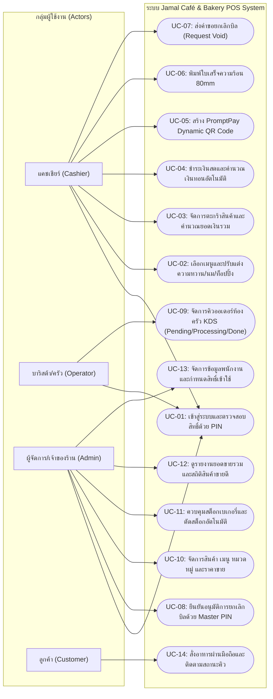
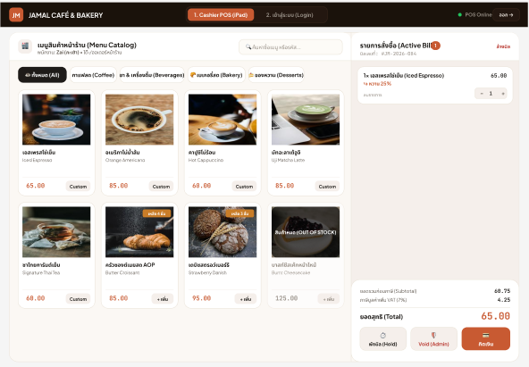
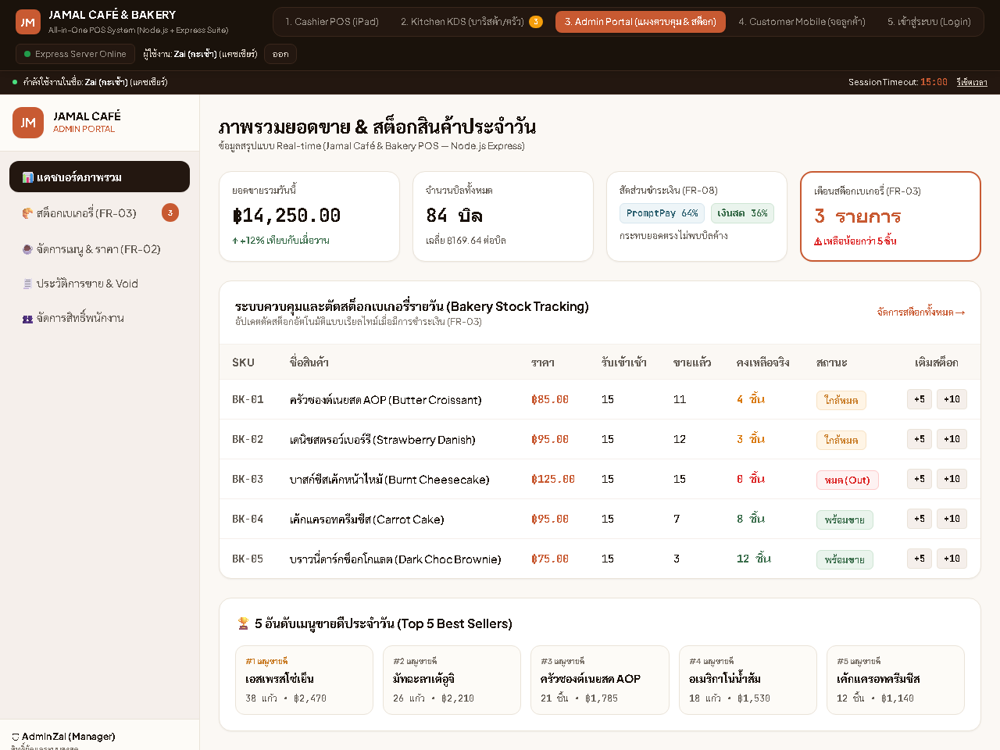

## รายชื่อสมาชิกกลุ่ม (Team Members)

| ลำดับ | รหัสนิสิต | ชื่อ - นามสกุล | GitHub Username |
| :---: | :---: | :--- | :--- |
| 1 | 68102010210 | นาย พิสิษฐ์ เสนีวงศ์ ณ อยุธยา | @AkashiZai |
| 2 | 68102010209 | นาย พิชยุตม์ เจียวพงษ์พิพัฒน์ | @Ctrl-Pichayut |
| 3 | 68102010203 | นาย ธราเทพ ศรีมานนท์ | @203Tharathep |
| 4 | 68102010190 | นาย ก้องเกียรติ อมรธรรมคุณ| @Kizizi123123 |
---
 
# POS ร้านคาเฟ่และเบเกอรี่ (Café & Bakery POS Web Application)
 
---

## แผนผังโครงสร้างโฟลเดอร์และทางลัดเข้าดู (Project Structure & Quick Navigation)

เพื่อให้การเปิดดูไฟล์ โค้ด เอกสาร รายงานผลการทดสอบ และงานออกแบบบน GitHub ทำได้สะดวกรวดเร็ว โครงสร้างโปรเจกต์ได้ถูกจัดระเบียบให้กดเข้าดูง่ายดังนี้:

| โฟลเดอร์ / ไฟล์ | รายละเอียด | ลิงก์ตรงบน GitHub |
| :--- | :--- | :--- |
| **`frontend/`** | ซอร์สโค้ดหลักของระบบ POS (Node.js & Express), Models และชุดทดสอบ | [เปิดดู frontend/](./frontend) |
| ├── **`models/`** | คลาสโครงสร้างข้อมูล 4 โมดูล (`StaffModel`, `CartModel`, `OrderQueueModel`, `InventoryModel`) | [เปิดดู models/](./frontend/models) |
| ├── **`tests/`** | ชุดทดสอบ Jest Unit Tests 4 Suites / 24 Tests (Statement Coverage 100%) | [เปิดดู tests/](./frontend/tests) |
| ├── **`tests/ui/`** | ชุดทดสอบ Playwright E2E UI Tests 5 เคส (Login, POS, KDS, Admin) | [เปิดดู tests/ui/](./frontend/tests/ui) |
| └── **`server.js`** | Express REST API รวม 16 Endpoints สำหรับจัดการระบบหน้าร้านและคลัง | [เปิดดู server.js](./frontend/server.js) |
| **`reports/`** | รายงานการวัดคุณภาพโค้ดและการทดสอบระบบ | [เปิดดู reports/](./reports) |
| └── **`plato/`** | รายงาน **Plato Static Complexity & Maintainability Index (HTML Dashboard)** | [เปิดดู reports/plato/](./reports/plato) |
| **`docs/`** | ศูนย์รวมเอกสารข้อกำหนดทางเทคนิค ผังกระบวนการทำงาน และภาพถ่ายหน้าจอ | [เปิดดู docs/](./docs) |
| ├── **`REQUIREMENT.md`** | ข้อกำหนดการทำงาน FR-01 ถึง FR-08 และ Non-Functional NFR-01 ถึง NFR-05 | [เปิดดู REQUIREMENT.md](./docs/REQUIREMENT.md) |
| ├── **`TOR.md`** | ขอบเขตงาน (Terms of Reference) สำหรับ Admin, User, Operator และ Authentication | [เปิดดู TOR.md](./docs/TOR.md) |
| ├── **`WORKFLOW_FLOWCHART.md`** | แผนผังระบบแบบละเอียด (Mermaid Flowchart) ครบ 4 ส่วนงาน | [เปิดดู WORKFLOW_FLOWCHART.md](./docs/WORKFLOW_FLOWCHART.md) |
| └── **`screenshots/`** | ภาพถ่ายหน้าจอระบบจริงทั้ง 5 หน้าจอหลัก | [เปิดดู screenshots/](./docs/screenshots) |
| **`design/`** | ทรัพยากรงานออกแบบ, Design Tokens และหน้าจอจำลอง Prototypes | [เปิดดู design/](./design) |
| ├── **`figma_pages/`** | หน้าจอจำลอง Prototype HTML (6 หน้า) และ Diagram ข้อกำหนด UI | [เปิดดู figma_pages/](./design/figma_pages) |
| ├── **`figma_import/`** | ไฟล์เวกเตอร์ SVG แท้จำนวน 39 หน้าจอ พร้อมนำเข้าสู่ Figma Canvas | [เปิดดู figma_import/](./design/figma_import) |
| └── **`tokens.json`** | Design Tokens สำหรับโทนสี, Typography และ Spacing | [เปิดดู tokens.json](./design/tokens.json) |
| **`scripts/`** | สคริปต์ Python สำหรับแปลง SVG และประมวลผลรูปภาพ | [เปิดดู scripts/](./scripts) |
| **`.github/workflows/`** | CI/CD Pipeline อัตโนมัติ (Unit Test, Coverage, Plato Report, ESLint, UI Test, CD Deploy) | [เปิดดู ci.yml](./.github/workflows/ci.yml) |
| **`package.json`** | สคริปต์ Root สำหรับรัน `npm test`, `npm run plato`, `npm start` ได้ทันทีจากโฟลเดอร์หลัก | [เปิดดู package.json](./package.json) |

---  
## 1. ที่มาของปัญหาและความสำคัญ (Problem Statement & Significance)
ในปัจจุบันธุรกิจร้านกาแฟและเบเกอรี่ขนาดย่อม (SMEs) มีการเติบโตขึ้นอย่างต่อเนื่อง แต่ร้านค้าส่วนใหญ่ยังประสบปัญหาในการบริหารจัดการหน้าร้าน ดังนี้:
1. **ความล่าช้าและความผิดพลาดในการรับออเดอร์**: การใช้กระดาษจดหรือเครื่องคิดเลขทำให้เกิดความผิดพลาดได้ง่าย โดยเฉพาะเมนูที่มีรายละเอียดซับซ้อน เช่น ระดับความหวาน ท็อปปิ้งเสริม
2. **ปัญหาการจัดการสต็อกสินค้าเบเกอรี่**: สินค้าประเภทเบเกอรี่มีอายุสั้นและรับมาจำนวนจำกัดต่อวัน การไม่มีระบบตัดสต็อกแบบ Real-time ส่งผลให้รับออเดอร์สินค้าที่หมดแล้ว เกิดความไม่พึงพอใจแก่ลูกค้า
3. **ความยุ่งยากในการสรุปบัญชีและรายงานยอดขาย**: เจ้าของร้านต้องเสียเวลาหลายชั่วโมงหลังปิดร้านเพื่อกระทบยอดเงินสดกับสลิปโอนเงิน และขาดข้อมูลสถิติเมนูขายดีในการวางแผนสต็อกวัตถุดิบล่วงหน้า

ทางกลุ่มจึงได้พัฒนา **Web-based Point of Sale (POS)** ขึ้น เพื่อช่วยให้การรับออเดอร์สะดวกรวดเร็ว ควบคุมสต็อกได้อัตโนมัติ และสรุปยอดขายได้แบบ Real-time ผ่านอุปกรณ์แท็บเล็ตหรือคอมพิวเตอร์

---
  
## 2. จุดประสงค์ของโครงการและประโยชน์ที่คาดว่าจะได้รับ (Objectives & Expected Benefits)

### จุดประสงค์ (Objectives)
1. เพื่อพัฒนาระบบคิดเงินและรับออเดอร์หน้าร้านที่ใช้งานง่าย รองรับตัวเลือกเมนูเครื่องดื่มและเบเกอรี่
2. เพื่อพัฒนาระบบตัดสต็อกเบเกอรี่อัตโนมัติเมื่อเกิดการขาย และแจ้งเตือนสินค้าใกล้หมด
3. เพื่อพัฒนาระบบคำนวณเงินทอนและรองรับการชำระเงินผ่าน QR Code PromptPay
4. เพื่อพัฒนาระบบสรุปยอดขายและแสดงแดชบอร์ดสถิติสินค้าขายดีสำหรับเจ้าของร้าน

### ประโยชน์ที่คาดว่าจะได้รับ (Expected Benefits)
1. **ลดเวลาและข้อผิดพลาด**: พนักงานคิดเงินได้เร็วขึ้นภายใน 15 วินาทีต่อบิล และลดปัญหาการทำออเดอร์ผิดพลาด
2. **ควบคุมสต็อกได้แม่นยำ**: ทราบจำนวนสต็อกเบเกอรี่คงเหลือแบบ Real-time ลดปัญหาสินค้าค้างสต็อกหรือของหมด
3. **ลดเวลาทำบัญชีประจำวัน**: สรุปยอดขายรายวันและแยกประเภทเงินสด/โอนเงินได้ทันทีหลังปิดร้าน
4. **เพิ่มประสิทธิภาพการวางแผนธุรกิจ**: เจ้าของร้านนำข้อมูลเมนูขายดีไปวางแผนการสั่งวัตถุดิบได้อย่างคุ้มค่า

---

## 3. ขอบเขตของโครงการ (Project Scope)

### สิ่งที่ระบบครอบคลุม (In-Scope)
* **การยืนยันตัวตนและสิทธิ์**: แยกสิทธิ์ระหว่าง แคชเชียร์ (Cashier) และ เจ้าของร้าน (Admin)
* **การจัดการเมนูสินค้า**: เพิ่ม/แก้ไข/ลบเมนู จัดหมวดหมู่ กำหนดตัวเลือก (ความหวาน, ท็อปปิ้ง)
* **ระบบขายหน้าร้าน (POS)**: เลือกเมนู คำนวณราคารวม ภาษี/ส่วนลด และส่งออเดอร์
* **การตัดสต็อก**: ตัดสต็อกสินค้าเบเกอรี่อัตโนมัติตามจำนวนที่ขาย
* **การชำระเงิน**: รองรับเงินสด (พร้อมคำนวณเงินทอน) และสร้าง QR Code PromptPay
* **ใบเสร็จ**: แสดงตัวอย่างใบเสร็จ (Receipt Preview) และสั่งพิมพ์สลิปขนาด 80mm
* **รายงานสรุป**: Dashboard ยอดขายประจำวัน, สถิติเมนูขายดี Top 5, ยอดแยกตามประเภทชำระเงิน

### สิ่งที่ยังไม่ครอบคลุมในเวอร์ชันนี้ (Out-of-Scope)
* การเชื่อมต่อกับเครื่องรูดบัตรเครดิต (EDC) โดยตรง
* ระบบสมาชิกสะสมแต้มขั้นสูง (Loyalty Point System)
* ระบบส่งออเดอร์เข้าจอห้องครัวอัตโนมัติ (Kitchen Display System - KDS)
* การเชื่อมต่อ API ธนาคารเพื่อตรวจสอบสลิปแบบอัตโนมัติ (ใช้การยืนยันยอดด้วยพนักงาน)

---

## 4. ความต้องการของระบบและคลิปการสอบถาม (System Requirements)

### 4.1 Functional Requirements (FR)
* **FR-01 (Authentication)**: ระบบสามารถเข้าสู่ระบบและแยกสิทธิ์การใช้งานระหว่าง Admin และ Cashier ได้
* **FR-02 (Menu Management)**: Admin สามารถเพิ่ม ลบ แก้ไข รายการสินค้า หมวดหมู่ ราคา และตัวเลือกสินค้าได้
* **FR-03 (Inventory Tracking)**: ระบบสามารถตัดสต็อกสินค้าเบเกอรี่อัตโนมัติเมื่อชำระเงินสำเร็จ และแสดงสถานะ "Out of Stock" เมื่อของหมด
* **FR-04 (Order Processing)**: Cashier สามารถเลือกรายการสินค้า เพิ่ม/ลดจำนวน กำหนดระดับความหวานและท็อปปิ้งได้
* **FR-05 (Payment Calculation)**: ระบบสามารถคำนวณยอดเงินรวม คำนวณเงินทอนสำหรับเงินสด และแสดง QR Code PromptPay พร้อมยอดเงินรวมได้
* **FR-06 (Receipt Generation)**: ระบบสามารถสร้างใบเสร็จรับเงิน และสั่งพิมพ์ผ่านเครื่องพิมพ์สลิปความร้อน (80mm Thermal Printer) ได้
* **FR-07 (Void Protection)**: การยกเลิกบิลหรือคืนเงิน (Void/Refund) ต้องใช้รหัสผ่านของ Admin ในการอนุมัติเท่านั้น
* **FR-08 (Sales Reporting)**: Admin สามารถดูรายงานยอดขายรวมประจำวัน ยอดขายแยกตามวิธีชำระเงิน และอันดับสินค้าขายดีได้

### 4.2 Non-Functional Requirements (NFR)
* **NFR-01 (Performance)**: หน้าจอขาย (POS) ต้องประมวลผลและตอบสนองการกดเลือกรายการได้ภายในเวลาไม่เกิน 1 วินาที
* **NFR-02 (Usability)**: หน้าจอ User Interface ต้องออกแบบให้มีปุ่มสัมผัสขนาดใหญ่ เหมาะสำหรับการใช้งานบนหน้าจอสัมผัส (Touchscreen/iPad)
* **NFR-03 (Reliability)**: ระบบต้องมีความเสถียร รองรับการใช้งานต่อเนื่องได้ตลอดทั้งวันโดยไม่มีอาการหน้าจอค้าง (Freeze)
* **NFR-04 (Security)**: มีระบบ Timeout Logout อัตโนมัติหากไม่มีการใช้งานเกิน 15 นาที เพื่อป้องกันการเข้าถึงข้อมูลโดยไม่ได้รับอนุญาต
* **NFR-05 (Portability)**: ระบบต้องรองรับการแสดงผลแบบ Responsive บน Web Browser ชั้นนำ (Google Chrome, Safari) บนแท็บเล็ตและคอมพิวเตอร์

---

## 5. ข้อกำหนดขอบเขตงาน (Terms of Reference - TOR)

# Front end spec 
1. มีหน้า Login / Register 
2. มีระบบ Authentication และ Role-based Access 
3. รองรับการใช้งานบน iOS, Android, Windows 
4. รองรับ Responsive Web Design 
# Front end spec for admin 
1. มีหน้าต่าง Dashboard แสดงข้อมูลภาพรวม เช่น ยอดขาย จำนวนบิล และสินค้าขายดี 
2. สามารถจัดการข้อมูลสินค้า เมนู ราคา และหมวดหมู่ 
3. สามารถจัดการข้อมูลผู้ใช้งานและสิทธิ์ 
4. สามารถดูประวัติรายการขายย้อนหลังและรายงานยอดขายได้ 
5. สามารถจัดการสต็อกและตรวจสอบสินค้าใกล้หมดได้ 
# Front end spec for user 
1. สามารถดูรายการสินค้าและรายละเอียดสินค้าได้ 
2. สามารถเลือกสินค้าและกำหนดจำนวนได้ 
3. สามารถเลือก Option ของสินค้า เช่น ความหวาน ท็อปปิ้ง และชนิดนม 
4. สามารถตรวจสอบรายการใน Cart และยอดรวมได้ 
5. สามารถตรวจสอบสถานะรายการสั่งซื้อและการชำระเงินได้
# Front end spec for operator 
1. มีหน้าจอเฉพาะสำหรับพนักงานในการจัดการรายการ 
2. สามารถดูรายการที่เข้ามาแบบ Real-time ได้ 
3. สามารถเปลี่ยนสถานะรายการ เช่น Pending, Processing, Completed 
4. มีระบบแจ้งเตือนเมื่อมีรายการใหม่หรือรายการมีการเปลี่ยนแปลง 
5. สามารถตรวจสอบรายละเอียดและประวัติรายการที่ดำเนินการแล้วได้ 

---

## 6. กระบวนการทำงานและเครื่องมือที่ใช้ (Process, Methods & Tools)
โครงการนี้ใช้ระเบียบวิธี **Agile Framework (Scrum)** ในการดำเนินงาน โดยแบ่งรอบการทำงานออกเป็น 5 Sprints (Sprint ละ 1 สัปดาห์) โดยใน Phase 2 (Sprint 2) ได้มีการขยายและกำหนดระเบียบวิธีปฏิบัติงานและเครื่องมือเพิ่มเติมอย่างเป็นรูปธรรม ดังนี้:

### 6.1 การติดตามสถานะของโปรเจกต์ (Project Tracking & Management)
* **เครื่องมือที่ใช้**: **GitHub Projects (Kanban Board)** และ **GitHub Issues / Milestones**
* **วิธีการดำเนินงาน**:
  * แปลง Requirement และข้อกำหนด TOR ออกเป็น User Stories และ Work Items (รวม 45 Issues: ปิดแล้ว 42 Issues ใน Sprint 1–4 และเปิดงานพัฒนาต่อยอดในอนาคต 3 Issues `#54–#56`) ผูกกับ Milestone ของแต่ละ Sprint (`Sprint1` ถึง `Sprint4`) ไว้อย่างชัดเจน
  * ใช้ Kanban Board (Project #3 View 2) ติดตามสถานะของงานผ่านคอลัมน์หลัก:
    * `Todo`: งานที่วางแผนไว้ใน Backlog หรือ Future Work (`#54–#56`) ที่ยังไม่ได้เริ่มลงมือทำ
    * `In Progress`: งานที่กำลังดำเนินการพัฒนาโค้ด ทดสอบ หรือออกแบบ UI
    * `Done`: งานที่ผ่านการทดสอบ Code Review และ Merge รวมเข้ากิ่งหลัก (`main`) เรียบร้อยแล้ว
  * มีการติดป้ายกำกับ (Labels) ชัดเจน เช่น `Feature`, `documentation`, `enhancement`, `Priority High`, `Priority Low` พร้อมระบุ Assignee ผู้รับผิดชอบครบทุกคน

### 6.2 ความถี่และพิธีกรรมของการทำ Scrum (Scrum Cadence & Ceremonies)
ทีมงานมีการจัดประชุม Scrum อย่างสม่ำเสมอตลอด Sprint 2 เพื่อให้งานส่งมอบได้ตรงเวลาและมีคุณภาพ:
1. **Sprint Planning (สัปดาห์ละ 1 ครั้ง)**: ประชุมต้นสัปดาห์เพื่อวิเคราะห์ User Stories, แตก Task ย่อย, ประเมิน Story Points และกำหนด Definition of Done (DoD) ของ Sprint
2. **Daily Standup (วันเว้นวัน หรือ 3 ครั้ง/สัปดาห์ ผ่าน Discord/Google Meet)**: ประชุมสั้นๆ 10-15 นาที โดยสมาชิกทุกคนตอบ 3 คำถามหลัก:
   * เมื่อวานทำอะไรเสร็จไปแล้วบ้าง?
   * วันนี้จะทำอะไรต่อ?
   * มีปัญหาหรืออุปสรรคใดที่ติดขัดหรือไม่ (Blockers)?
3. **Sprint Review & Demo (สิ้นสุด Sprint)**: นำชิ้นงาน Figma Prototype และ Web Application มาทดสอบการคลิกและจำลองเหตุการณ์ร่วมกัน
4. **Sprint Retrospective (สิ้นสุด Sprint ละ 1 ครั้ง)**: ประชุมทบทวนผลการทำงาน (What went well, What could be improved, Action items) พร้อมบันทึกวิดีโอสรุป

### 6.3 มาตรฐานการตั้งชื่อ Branch และ Commit (Git Branching & Commit Convention)
ทีมใช้กลยุทธ์ **Feature Branch Workflow** โดยแตกกิ่งย่อยออกจาก `main` ตามรหัสสมาชิกและหมายเลข Ticket (ตามข้อกำหนด Naming Convention):
* **รูปแบบการตั้งชื่อ Branch (Branch Format)**: `<nameid>_<ticketid>`
  * ตัวอย่าง Branch จริงในโปรเจกต์: `akashizai_12`, `203tharathep_33`, `ctrlpichayut_8`, `kizizi123123_10`, `kizizi123123_57` (รวม 13 Feature Branches ตลอด 4 Sprints)
* **รูปแบบข้อความ Commit (Commit Format)**: `<ticketid>: <msg>` (ความยาว > 8 ตัวอักษร) เช่น `12: add social login flow`, `48: sync README coverage metrics`
* **ข้อกำหนด**: สมาชิกจะไม่ Push โค้ดตรงเข้ากิ่ง `main` หากยังไม่ผ่านการทดสอบเบื้องต้น และเมื่อฟีเจอร์เสร็จสมบูรณ์จะต้องเปิด Pull Request เพื่อทำ Code Review ก่อนทำการ Merge

### 6.4 ช่องทางและแนวทางการสื่อสารในช่วงการทำโปรเจกต์ (Team Communication Channels)
ทีมงานผสมผสานการสื่อสารทั้งแบบ Synchronous (แบบเรียลไทม์) และ Asynchronous (แบบต่างเวลา) ดังนี้:
1. **Discord (Voice & Screen Sharing)**: ใช้สำหรับการจัดประชุม Standup, Live Pair-Programming, และการแชร์หน้าจอเพื่อทดสอบ Prototype บน Figma ร่วมกัน
2. **LINE Group**: ใช้สำหรับการส่งข้อความแจ้งเตือนด่วน, นัดหมายเวลาประชุม, และแชร์ลิงก์ไฟล์งานสำคัญ
3. **GitHub Pull Requests & Discussions**: ใช้สำหรับการทำ Code Review, คอมเมนต์ติชมโค้ด, ตรวจสอบ Diff และอนุมัติการ Merge เข้าสู่กิ่งหลัก
4. **Figma Comments**: ใช้เครื่องมือ Comment ใน Figma เพื่อปักหมุดจุดที่ต้องการปรับปรุง UI, ตำแหน่งปุ่ม และขนาดตัวอักษรระหว่างฝ่ายออกแบบและฝ่ายพัฒนา

---

## 7. สรุปขั้นตอนการเก็บรวบรวมและคลิปการสอบถาม Requirement (Requirement Collection Summary & Video)

คลิบวิดีโอ Requirement https://youtu.be/mrEzVA0Pjyg

1. **การกำหนดกลุ่มเป้าหมาย**: เลือกผู้ประกอบการร้านคาเฟ่และเบเกอรี่ขนาดย่อมเป็นผู้ให้ความต้องการ
2. **การเตรียมชุดคำถาม**: จัดทำคำถามสัมภาษณ์ 6 หมวดหมู่ (บริบทและปัญหา, สิทธิ์ผู้ใช้, สินค้าและสต็อก, การชำระเงิน, รายงาน, และขอบเขตทางเทคนิค)
3. **การสัมภาษณ์และบันทึกข้อมูล**: สัมภาษณ์ผ่านทางออนไลน์และจดบันทึกประเด็นปัญหา (Pain Points) หลัก ได้แก่ การคิดเงินช้า, สต็อกเบเกอรี่ไม่ตรง, และการสรุปยอดขายยาก
4. **การวิเคราะห์และจัดกลุ่ม Requirement**: นำผลสัมภาษณ์มาคัดกรอง แยกเป็น Functional / Non-Functional Requirements และกำหนดขอบเขต In-Scope / Out-of-Scope ร่วมกันในทีม

---


## 8. สรุปผลการประชุมทบทวนการทำงาน (Sprint 1 Retrospective)

คลิปวิดีโอสรุปการประชุม Retrospective https://youtu.be/IORRQBUFmWI

เมื่อสิ้นสุดการทำงานใน Sprint 1 (Due date: 9 กันยายน 2569) ทีมงานได้จัดประชุมทบทวนการทำงานร่วมกัน (Retrospective) สรุปประเด็นสำคัญจากที่ประชุมได้ดังนี้

### 1. สิ่งที่ทำได้ดี (What went well)

ทีมงานทุกคนมีความเข้าใจในปัญหาของร้านคาเฟ่ตรงกัน ทำให้การกำหนดขอบเขตงาน (Scope) ทำได้ชัดเจนตั้งแต่ต้น 
การกระจายงานเขียนเอกสารและการกำหนด User Story บน GitHub มีการแบ่งหน้าที่กันอย่างชัดเจน 

### 2. สิ่งที่ควรปรับปรุง (What could be improved)

ควรระบุขนาดและหน่วยของสต็อกสินค้าให้ละเอียดมากขึ้นในสปรินต์ถัดไป 
การออกแบบ UI ใน Figma ควรเริ่มทำคู่ขนานไปพร้อมกับการพัฒนา Backend API ทันทีตั้งแต่ Sprint 2 

### 3. สิ่งที่ต้องทำต่อไป (Next Steps / Action Items)

เริ่มต้นพัฒนาโครงสร้างโปรเจกต์ (Project Setup) และทำหน้า Login เป็นลำดับแรกใน Sprint 2 ตาม Backlog ที่วางไว้

---


## 9. ภาพหน้าจอการทำงานบน GitHub (Screenshots & Explanations)
9.1 Product Backlog (Work Items & User Stories)


คำอธิบาย: หน้า GitHub Issues แสดงรายการ Work Items และ User Stories ทั้งหมดของโปรเจกต์ (รวม 10 Issues) ครอบคลุมทั้งงานเอกสาร (label documentation) และฟีเจอร์ของระบบ (label Feature) โดยแต่ละรายการมีการติด Priority (Priority High / Priority Low) และผูกกับ Milestone ของแต่ละ Sprint (Sprint1–Sprint4) ไว้อย่างชัดเจน

9.2 Sprint Backlog & Milestones


คำอธิบาย: หน้า GitHub Milestones แสดงการแบ่งงานออกเป็น 4 Sprint (Sprint1–Sprint4) แต่ละ Sprint มีการกำหนด Due Date และจำนวน Issue ที่ต้องทำให้เสร็จอย่างชัดเจน เช่น Sprint 1 (Due 9 ก.ย. 2569) มี 4 Issues ครอบคลุมงาน Requirement, TOR, README และ Retrospective ส่วน Sprint 2–4 เป็น User Story ของฟีเจอร์หลักของระบบ POS ตามลำดับ

9.3 ตัวอย่างรายละเอียดของ Issue (Issue Detail)


คำอธิบาย: ตัวอย่างรายละเอียดของ Issue #5 "[User Story] User Authentication and Role-based Access" แสดงโครงสร้าง User Story ในรูปแบบ "As a Staff/Owner, I want to login with my credentials so that I can access the system with my assigned role permissions." พร้อม Assignee (203Tharathep), Label (Feature, Priority High), Milestone (Sprint2) และสถานะบน Project Board (Todo)


---

## 10. สรุปการเปลี่ยนแปลง Requirement และขอบเขตงานใน Phase 2 (Requirement & Scope Changes)

### 10.1 สิ่งที่เปลี่ยนแปลงจากรายงาน Phase 1 และเหตุผลที่เปลี่ยน (Changes from Phase 1)
จากการดำเนินงานและทบทวนความต้องการร่วมกันในทีมช่วง Sprint 2 ทีมงานได้มีการปรับปรุงและขยายขอบเขตงานจากรายงาน Phase 1 ดังต่อไปนี้:

1. **การขยายขอบเขตหน้าจอระบบ (Scope & Deliverables Expansion)**:
   * *เดิม (Phase 1)*: วางแผนพัฒนาเฉพาะ 2 หน้าจอหลัก คือ หน้าจอเข้าสู่ระบบ (Login) และหน้าจอขายหน้าร้าน (Cashier POS)
   * *สิ่งที่เปลี่ยน (Phase 2)*: พัฒนาและออกแบบหน้าจอเพิ่มเป็น 5 โมดูลระบบแบบครบวงจร ได้แก่ หน้าเข้าสู่ระบบ (Login), หน้าจอขายหน้าร้าน (Cashier POS), หน้าจอกระดานคิวห้องครัวและบาริสต้า (Kitchen KDS), หน้าจอแผงควบคุมเจ้าของร้านและสต็อก (Admin Portal), และหน้าจอลูกค้าสั่งอาหารผ่านมือถือ (Customer Mobile)
   * *เหตุผลที่เปลี่ยน*: เพื่อให้เห็น Flow การทำงานแบบบูรณาการตั้งแต่ต้นน้ำถึงปลายน้ำ (End-to-End Workflow) โดยออเดอร์ที่แคชเชียร์รับหน้าร้านจะถูกส่งต่อไปยังห้องครัวทันที และข้อมูลสต็อกสินค้าจะถูกตัดและรายงานขึ้นแดชบอร์ดของผู้จัดการแบบ Real-time
2. **การนำระบบ Design Tokens และ UI Standardization มาใช้**:
   * *เดิม (Phase 1)*: การออกแบบยังไม่ได้กำหนดโทนสีและสเปกการจัดวางที่แน่นอน
   * *สิ่งที่เปลี่ยน (Phase 2)*: จัดทำไฟล์ `tokens.json` และคู่มือ `FIGMA_SPEC.md` โดยกำหนด Palette สี Artisanal Warm Modernist (Dark Espresso, Warm Cream, Terracotta, Sage Matcha), Spacing, Border Radius และ Typography (Plus Jakarta Sans, Sarabun)
   * *เหตุผลที่เปลี่ยน*: เพื่อควบคุมทิศทางการออกแบบให้เป็นเอกภาพ (Consistency) ป้องกันความคลาดเคลื่อนเมื่อสมาชิกแต่ละคนแยกย้ายกันพัฒนาโค้ดและทำ UI ใน Figma
3. **การเพิ่มระบบความปลอดภัย Session Timeout (NFR-04)**:
   * *เดิม (Phase 1)*: มีการระบุไว้ใน NFR แต่ยังไม่มีกลไกจำลองการทำงาน
   * *สิ่งที่เปลี่ยน (Phase 2)*: เพิ่มระบบตัวจับเวลานับถอยหลัง 15 นาที หากไม่มีการสัมผัสหรือทำรายการบนหน้าจอ จะทำการ Logout และตัด Session อัตโนมัติทันที
   * *เหตุผลที่เปลี่ยน*: หน้าเคาน์เตอร์ร้านกาแฟมีความพลุกพล่าน การมีระบบล็อกอัตโนมัติจะช่วยป้องกันการแอบกดทำรายการหรือการเข้าถึงข้อมูลยอดขายโดยไม่ได้รับอนุญาต
4. **การปรับปรุงระบบคิดเงินสด Numpad และสลิปความร้อน 80mm ให้สมจริง**:
   * *เดิม (Phase 1)*: ออกแบบการคิดเงินเบื้องต้น
   * *สิ่งที่เปลี่ยน (Phase 2)*: เพิ่มแป้นตัวเลข Numpad, ปุ่มลัดเงินสดด่วน (฿100, ฿500, ฿1,000, พอดี), ระบบคำนวณเงินทอนอัตโนมัติ และแบบจำลองใบเสร็จความร้อน 80mm Thermal Slip
   * *เหตุผลที่เปลี่ยน*: เพื่อตอบสนองความต้องการด้านความเร็ว (NFR-01) ให้แคชเชียร์สามารถปิดบิลได้รวดเร็วภายใน 15 วินาที

### 10.2 การเปลี่ยนแปลงและเพิ่มเติม Functional Requirements ใน Phase 2
จากการขยายขอบเขตงาน ทีมงานได้เพิ่มเติม Functional Requirements เพื่อรองรับการทำงานของระบบให้สมบูรณ์ยิ่งขึ้น:

| รหัส Requirement | ชื่อข้อกำหนด | คำอธิบายการทำงาน | ประเภทการเปลี่ยนแปลง |
| :---: | :--- | :--- | :---: |
| **FR-09** | Kitchen Order Notification & Queue Tracking | ระบบกระดานคิวห้องครัว (KDS) สามารถรับออเดอร์ใหม่แบบ Real-time พร้อมเสียงเตือนกระดิ่ง และบาริสต้าสามารถกดเปลี่ยนสถานะ (Pending → Processing → Completed) ได้ | **เพิ่มเติมใหม่ (New)** |
| **FR-10** | Customer Mobile Queue Self-Tracking | ลูกค้าสามารถดูรายการสินค้าและติดตามสถานะคิวคำสั่งซื้อของตนเองผ่านสมาร์ทโฟนได้แบบ Real-time | **เพิ่มเติมใหม่ (New)** |
| **FR-11** | Dynamic Menu & Pricing Administration | ผู้ดูแลระบบสามารถเปิดหน้าต่าง Modal เพื่อเพิ่มเมนูใหม่ กำหนดหมวดหมู่ ราคาขาย ต้นทุน และตัวเลือก Customization ได้ | **ปรับปรุงความละเอียด (Enhanced from FR-02)** |
| **FR-12** | Staff Role & PIN Management | ผู้ดูแลระบบสามารถเพิ่มบัญชีพนักงาน กำหนดระดับสิทธิ์ (Cashier, Operator, Admin) และตั้งรหัส PIN 4 หลักได้ | **ปรับปรุงความละเอียด (Enhanced from FR-01)** |

---

## 11. เอกสารการออกแบบระบบ (Design Document)

### 11.1 แผนภาพ Use Case (Use Case Diagram)
แผนภาพ Use Case Diagram ด้านล่างนี้แสดงความสัมพันธ์ระหว่างผู้ใช้งานระบบ 4 กลุ่ม (Actors) กับฟังก์ชันการทำงานหลักของระบบ Jamal Café & Bakery Web POS:



#### ตารางสรุปรายละเอียด Use Cases หลัก
| Use Case ID | ชื่อ Use Case | Actor หลัก | วัตถุประสงค์ |
| :---: | :--- | :--- | :--- |
| **UC-01** | เข้าสู่ระบบและตรวจสอบสิทธิ์ | Cashier, Barista, Admin | ยืนยันตัวตนด้วยรหัส PIN 4 หลัก และกระจายไปยังหน้าจอตามระดับสิทธิ์ |
| **UC-02** | เลือกและปรับแต่งสินค้า | Cashier | เลือกสินค้าและปรับระดับความหวาน (0-100%), ชนิดนม, และท็อปปิ้ง |
| **UC-03** | จัดการตะกร้าสินค้า | Cashier | ตรวจสอบรายการ คำนวณราคาย่อย ภาษีมูลค่าเพิ่ม 7% และยอดสุทธิ |
| **UC-04** | ชำระเงินสด | Cashier | รับเงินสดผ่านแป้น Numpad หรือปุ่มลัดธนบัตร และคำนวณเงินทอน |
| **UC-05** | ชำระเงินผ่าน PromptPay | Cashier | แสดง QR Code พร้อมยอดเงินสุทธิให้ลูกค้าสแกนจ่ายผ่าน Mobile Banking |
| **UC-06** | พิมพ์ใบเสร็จรับเงิน 80mm | Cashier | สั่งพิมพ์สลิปกระดาษความร้อนที่มีรายละเอียดสินค้า ภาษี และเลขอ้างอิง |
| **UC-07** | ขอยกเลิกบิล (Void) | Cashier | ร้องขอการยกเลิกบิลผิดพลาดและส่งเรื่องให้ผู้จัดการอนุมัติ |
| **UC-08** | อนุมัติการยกเลิกบิล | Admin | กรอกรหัส Master Passcode เพื่ออนุมัติยกเลิกบิลและคืนสต็อกสินค้า |
| **UC-09** | จัดการคิวครัว KDS | Barista | รับออเดอร์ใหม่ เปลี่ยนสถานะกำลังชง และเสร็จสิ้นเพื่อแจ้งเรียกลูกค้า |
| **UC-10** | จัดการเมนูและราคา | Admin | เพิ่มรายการสินค้าใหม่ แก้ไขราคา ปรับตัวเลือก และเปิด/ปิดการขาย |
| **UC-11** | ควบคุมสต็อกสินค้า | Admin | ตรวจสอบสต็อกคงเหลือ แจ้งเตือน Low Stock (<5 ชิ้น) และเติมสต็อก |
| **UC-12** | ดูรายงานสรุปยอดขาย | Admin | ตรวจสอบยอดขายรวมประจำวัน จำนวนบิล สัดส่วนการชำระ และสินค้าขายดี Top 5 |
| **UC-13** | จัดการสิทธิ์พนักงาน | Admin | เพิ่มบัญชีพนักงานใหม่ กำหนดบทบาท และตั้งรหัสผ่าน/PIN |
| **UC-14** | สั่งและติดตามคิวบนมือถือ | Customer | ดูเมนูสินค้า สั่งซื้อ และติดตามสถานะการชงเครื่องดื่มแบบ Real-time |

---

### 11.2 แผนภาพสถาปัตยกรรมระบบ (System Architecture Diagram)
ระบบ Jamal Café & Bakery Web POS ได้รับการออกแบบตามรูปแบบ Layered Architecture เพื่อแยกความรับผิดชอบของระบบออกเป็นชั้นๆ อย่างชัดเจน (Separation of Concerns):


#### รายละเอียดโครงสร้างแต่ละชั้น (Layer Breakdown)
1. **Presentation Layer (ชั้นการแสดงผล)**: รองรับการแสดงผลแบบ Responsive บนอุปกรณ์หลากหลายขนาด ทั้งแท็บเล็ต iPad สำหรับแคชเชียร์/บาริสต้า, จอคอมพิวเตอร์สำหรับผู้จัดการร้าน และมือถือสมาร์ทโฟนสำหรับลูกค้า ตามข้อกำหนด NFR-02 และ NFR-05
2. **Web Application Layer (ชั้นหน้าเว็บแอปพลิเคชัน)**: พัฒนาด้วย HTML5, Vanilla JavaScript (`public/app.js`) และ Tailwind CSS ตามข้อกำหนด Design System โดยแยกโมดูลการแสดงผลแต่ละหน้าจออย่างเป็นสัดส่วน
3. **Backend API & Business Logic Layer (ชั้นตรรกะและ Express Server)**: พัฒนาด้วย **Node.js + Express** (`frontend/server.js`) ให้บริการ REST API สำหรับซิงค์ข้อมูลระหว่างหน้าจอ พร้อมโมดูลความปลอดภัยจับเวลา 15 นาที (`NFR-04`), กลไกคำนวณเงินและภาษี, เครื่องจักรสถานะออเดอร์ (State Machine), และระบบตัดสต็อกอัตโนมัติ
4. **Data & Foundations Layer (ชั้นข้อมูลและโครงสร้างพื้นฐาน)**: จัดการคลังข้อมูลบนฝั่ง Server, ระบบสร้าง Dynamic PromptPay QR Code, ระบบพิมพ์สลิป 80mm และชุดสี Design Tokens

---

## 12. ภาพหน้าจอระบบและลิงก์งานออกแบบ (Website Screenshots & Figma Prototype)

### 12.1 ลิงก์งานออกแบบบน Figma (Figma Project Link)
* **Figma Prototype Link**: [คลิกที่นี่เพื่อเปิดดูชิ้นงาน Jamal POS บน Figma](https://www.figma.com/design/DSn2mfMqepHiauo2lbwBFV/jamal?node-id=0-1&t=TBf61dXn3PTERRvu-1)
* **Figma Assets ใน Repository**: ไฟล์สำหรับนำเข้า Figma และ Interactive Prototypes จัดเก็บไว้ในโฟลเดอร์ [`design/figma_pages/`](./design/figma_pages) และไฟล์เวกเตอร์ SVG จำนวน 39 หน้าจอในโฟลเดอร์ [`design/figma_import/`](./design/figma_import)

---

### 12.2 ภาพหน้าจอระบบจริง (Browser Web Application Screenshots)

#### 1) หน้าจอเข้าสู่ระบบ (Login & PIN Authentication Screen)
* **เส้นทางไฟล์**: [`frontend/server.js`](./frontend/server.js), [`frontend/public/app.js`](./frontend/public/app.js)
* **คำอธิบาย**: หน้าต่างสำหรับเข้าสู่ระบบพร้อมตัวเลือกบทบาท (แคชเชียร์, บาริสต้า, ผู้ดูแลร้าน) และแป้นกรอกรหัส PIN 4 หลัก รองรับการตรวจสอบสิทธิ์ผ่าน Express API (`/api/auth/login`) และระบบความปลอดภัย Timeout 15 นาที (NFR-04)


---

#### 2) หน้าจอแคชเชียร์ขายหน้าร้าน (Cashier POS Screen)
* **เส้นทางไฟล์**: [`frontend/server.js`](./frontend/server.js), [`frontend/public/app.js`](./frontend/public/app.js)
* **คำอธิบาย**: หน้าจอขายหน้าร้านสำหรับ iPad 11" แสดงหมวดหมู่สินค้า การ์ดเมนูกาแฟ/เบเกอรี่ ช่องค้นหา ตะกร้าสินค้าด้านขวา และปุ่มพักบิล/คิดเงิน พร้อมป๊อปอัปปรับแต่งความหวานและชนิดนม (FR-04, NFR-01, NFR-02)



---

#### 3) หน้าจอคิดเงินสดและใบเสร็จความร้อน 80mm (Payment Modal & Receipt Slip)
* **เส้นทางไฟล์**: [`frontend/server.js`](./frontend/server.js), [`frontend/public/app.js`](./frontend/public/app.js)
* **คำอธิบาย**: หน้าต่างคิดเงินสดพร้อมแป้น Numpad, ปุ่มลัดธนบัตร (฿100, ฿500, ฿1,000, พอดี), ระบบคำนวณเงินทอนอัตโนมัติ และพรีวิวใบเสร็จรับเงินขนาด 80mm พร้อมพิมพ์สลิป (FR-05, FR-06)


---

#### 4) หน้าจอกระดานคิวห้องครัวและบาริสต้า (Kitchen KDS Kanban Board)
* **เส้นทางไฟล์**: [`frontend/server.js`](./frontend/server.js), [`frontend/public/app.js`](./frontend/public/app.js)
* **คำอธิบาย**: กระดานคิวออเดอร์แบบ 3 คอลัมน์ (รอดำเนินการ -> กำลังชง/อบ -> พร้อมเสิร์ฟ) มีเสียงเตือนออเดอร์ใหม่ และปุ่มกดเปลี่ยนสถานะงานผ่าน Express API (`/api/orders/:id/status`) (TOR Operator 1-5)


---

#### 5) หน้าจอแผงควบคุมเจ้าของร้าน จัดการสต็อกและเมนู (Admin Dashboard & Inventory)
* **เส้นทางไฟล์**: [`frontend/server.js`](./frontend/server.js), [`frontend/public/app.js`](./frontend/public/app.js)
* **คำอธิบาย**: แดชบอร์ดสรุปยอดขายรวมประจำวัน สัดส่วนเงินสด/โอนเงิน สินค้าขายดี Top 5, ตารางควบคุมสต็อกเบเกอรี่, ป๊อปอัปเพิ่มเมนูใหม่/แก้ไขราคา (FR-02), ป๊อปอัปเพิ่มบัญชีพนักงาน และระบบขออนุมัติ Void บิล (FR-07, FR-08)



---

#### 6) หน้าจอลูกค้าสั่งอาหารและติดตามคิวบนมือถือ (Customer Mobile Ordering)
* **เส้นทางไฟล์**: [`frontend/server.js`](./frontend/server.js), [`frontend/public/app.js`](./frontend/public/app.js)
* **คำอธิบาย**: หน้าจอมือถือ (Viewport 393×852) สำหรับลูกค้าสแกนดูเมนู ปรับแต่งความหวาน สั่งสินค้า และติดตามสถานะคิวคำสั่งซื้อ (#A03) แบบ Real-time (TOR User 1-5)

<!-- ตัวอย่างหน้าจอ Mobile สำหรับลูกค้า -->
<p align="center"><em>(แสดงผลในรูปแบบ Responsive Mobile Web ผ่าน Viewport 393×852)</em></p>

---

## 13. สรุปผลการประชุมทบทวนการทำงาน (Sprint 2 Retrospective).

* **วัน-เวลาที่ประชุม**: 3 ตุลาคม 2569 (สิ้นสุด Sprint 2)
* **คลิปวิดีโอสรุปการประชุม Retrospective Sprint 2**: https://www.youtube.com/watch?v=abTyFi0K3_4

เมื่อสิ้นสุดการทำงานใน Sprint 2 ทีมงานได้จัดประชุมทบทวนการทำงานร่วมกันเพื่อประเมินความคืบหน้าของงานออกแบบและ Prototype โดยมีข้อสรุปดังนี้:

### 1. สิ่งที่ทำได้ดี (What went well)
1. **การออกแบบ UI และ Asset ใน Figma ครบถ้วนเกินเป้าหมาย**: ทีมสามารถออกแบบและจัดเตรียมไฟล์เวกเตอร์ SVG ได้ครบถ้วนทั้ง 5 โมดูลระบบ รวม 39 หน้าจอ/สถานะเหตุการณ์ ทำให้เห็น Flow การคลิกและ Interaction ที่สมบูรณ์แบบโดยไม่มี Dead Click
2. **การทำ Design Tokens ทำให้หน้าเว็บสอดคล้องกับดีไซน์ 100%**: การจัดทำไฟล์ `tokens.json` และคู่มือ `FIGMA_SPEC.md` ช่วยให้การเขียน CSS ในหน้าเว็บ (Node.js + Express) มีสี ฟอนต์ และขนาดปุ่มที่ตรงกับ Figma อย่างแม่นยำ
3. **การทำงานร่วมกันบน Git และการแบ่งงาน 4 ส่วนชัดเจน**: สมาชิกแต่ละคนรับผิดชอบโมดูลของตนเองตามตารางอย่างเคร่งครัด ทำให้การ Merge โค้ดและการอัปโหลดงานเข้าโฟลเดอร์ `design/figma_pages/` ไม่มีข้อขัดแย้ง (Merge Conflict)

### 2. สิ่งที่ควรปรับปรุง (What could be improved)
1. **การจัดเก็บข้อมูลบน Express Server ยังเป็น In-Memory State**: ข้อมูลสินค้า บิลขาย และคิวครัว ทำงานอยู่บนหน่วยความจำของ Node.js Express Server ควรเชื่อมต่อ Database ถาวรใน Sprint 3
2. **การทดสอบบนอุปกรณ์สัมผัสจริง (Real Hardware Testing)**: การทดสอบส่วนใหญ่ยังทำบนคอมพิวเตอร์ผ่านการจำลองขนาดหน้าจอ (DevTools) ใน Sprint ถัดไปควรนำแท็บเล็ต iPad มาเปิดทดสอบ Touch Target เพื่อประเมินความคล่องตัวในการกดของแคชเชียร์จริง
3. **การจัดการข้อผิดพลาดของเครือข่าย (Offline Fallback)**: ควรออกแบบระบบรองรับกรณีสัญญาณอินเทอร์เน็ตหลุดชั่วขณะ เพื่อให้หน้าจอขายหน้าร้านยังคงทำงานได้ต่อเนื่องตามข้อกำหนด NFR-03

### 3. สิ่งที่ต้องทำต่อไปใน Sprint 3 (Next Steps / Action Items)
1. **พัฒนาโครงสร้าง Backend API**: พัฒนา Node.js / Express หรือ Next.js API Routes เพื่อรองรับ Endpoint การสร้างบิล, การตัดสต็อกสินค้า, และการเรียกดูประวัติการขาย
2. **ออกแบบและเชื่อมต่อฐานข้อมูล PostgreSQL / Supabase**: สร้างตาราง `users`, `products`, `orders`, `order_items`, `inventory_logs` ตาม ER-Diagram เพื่อบันทึกข้อมูลถาวร
3. **พัฒนาระบบ Real-time Synchronisation (WebSocket / Supabase Realtime)**: เพื่อให้ออเดอร์ที่ชำระเงินจากหน้า POS เด้งขึ้นบนจอ Kitchen KDS และจอมือถือลูกค้าได้แบบ Real-time โดยไม่ต้อง Refresh
4. **ทำ Integration Testing**: ทดสอบการทำงานร่วมกันระหว่าง Frontend, Backend และ Database เพื่อเตรียมพร้อมสำหรับส่งมอบใน Phase ถัดไป

---

### การทำงานของโปรแกรมและสรุปจำนวน HTTP Methods / API (Phase 3 & Phase 4)
ระบบพัฒนาด้วย **Node.js + Express** (`frontend/server.js`) มีสถาปัตยกรรมการทำงานดังนี้:

* **การใช้ Template:** `server.js` ใช้ Express Static Serving (`express.static(path.join(__dirname, 'public'))`) เสิร์ฟ SPA Template จาก [`frontend/public/index.html`](./frontend/public/index.html) ร่วมกับ [`public/style.css`](./frontend/public/style.css) และ [`public/app.js`](./frontend/public/app.js) เพื่อเรนเดอร์ UI ทั้ง 5 หน้าจอ (`renderLoginPage()`, `renderPosPage()`, `renderKdsPage()`, `renderAdminPage()`, `renderCustomerMobilePage()`) แบบ Dynamic ฝั่ง Client
* **การเรียกใช้งาน API:** ฝั่ง Client (`app.js`) ติดต่อกับ Express Server ผ่าน `fetch('/api/...')` แบบ JSON (เช่น `fetchState()`, `apiCreateOrder()`, `apiAdvanceOrderStatus()`, `apiRestockProduct()`, `apiVoidReceipt()`, `apiAddStaff()`) แล้วส่งต่อไปประมวลผลใน Data Structure 4 คลาส (`StaffModel`, `CartModel`, `OrderQueueModel`, `InventoryModel`) ภายใน [`frontend/models/`](./frontend/models)
* **การคำนวณหลัก (`Calculations`):**
  1. `CartModel.calculateBill()` คำนวณยอดรวมท็อปปิ้ง, ราคาก่อน VAT (`totalAmount / 1.07`), ภาษีมูลค่าเพิ่ม 7% (`vatAmount`) และเงินทอน (`changeDue`)
  2. `OrderQueueModel.getQueueStats()` คำนวณจำนวนออเดอร์แยกตามสถานะ และค่ายอดสั่งซื้อเฉลี่ย ต่ำสุด สูงสุด (`averageAmount`, `minAmount`, `maxAmount`)
  3. `InventoryModel.getSalesAnalytics()` คำนวณรายได้สุทธิ จำนวนบิล และ `averageBill` / `minBill` / `maxBill` โดยคัดบิลที่ถูก Void ออก
* **กราฟและแผนภาพในระบบ (`Graphs & Visualizations`):** หน้า Admin Dashboard แสดงกราฟแท่งเปรียบเทียบสัดส่วนการชำระเงิน (`PromptPay` vs `Cash`) และอันดับสินค้าขายดี Top 5, โฟลเดอร์ [`reports/plato/`](./reports/plato) แสดงกราฟวิเคราะห์ความซับซ้อนและ Maintainability Index และเอกสาร Markdown แสดง Mermaid Diagrams (Use Case, System Architecture, Workflow Flowchart)

#### สรุปรายการ REST API Endpoints รวม 16 เส้นทาง (`frontend/server.js`)
- **GET (5 methods):**
  1. `GET /api/state` — ดึงข้อมูลเริ่มต้นทั้งหมด (Categories, Products, Toppings, Staff, Orders, Sales, Sorted Inventory)
  2. `GET /api/inventory/sorted` — ดึงรายงานสต็อกสินค้า (Base Drink, Cake, Toppings) เรียงจากน้อยไปมาก
  3. `GET /api/catalog/search` — ค้นหาเครื่องดื่ม เบเกอรี่ และท็อปปิ้งด้วยคีย์เวิร์ด (`q`, `category`)
  4. `GET /api/queue/stats` — ดึงรายการออเดอร์ตามสถานะและสถิติยอดคำสั่งซื้อในคิว (`average`, `min`, `max`)
  5. `GET *` — เสิร์ฟหน้า Single-Page Application Template (`public/index.html`)
- **POST (7 methods):**
  1. `POST /api/auth/login` — ตรวจสอบสิทธิ์ด้วย Username และรหัส PIN 4 หลัก
  2. `POST /api/auth/social` — เข้าสู่ระบบผ่าน Gmail / Facebook (Social Login)
  3. `POST /api/orders` — สร้างออเดอร์ใหม่ ตัดสต็อกอัตโนมัติ และบันทึกยอดขาย
  4. `POST /api/products` — เพิ่มรายการเมนูใหม่เข้าคลังสินค้า
  5. `POST /api/products/:id/restock` — เติมสต็อกสินค้าหรือท็อปปิ้ง
  6. `POST /api/sales/:receiptNo/void` — ยกเลิกบิลด้วยสิทธิ์ผู้จัดการ (Admin Override)
  7. `POST /api/staff` — เพิ่มบัญชีพนักงานใหม่เข้าสู่ระบบ
- **PUT / PATCH / DELETE (4 methods):**
  1. `PUT /api/products/:id` — แก้ไขรายละเอียดสินค้า หมวดหมู่ ราคา และตัวเลือก
  2. `PATCH /api/products/:id/price` — แก้ไขราคาขายด่วน
  3. `PATCH /api/orders/:id/status` — เปลี่ยนสถานะคิวครัว KDS (`pending` -> `in_progress` -> `ready` -> `completed`)
  4. `DELETE /api/products/:id` — ลบรายการสินค้าออกจากระบบ

### การทำ CI/CD Pipeline (Free-tier Parallel Jobs) และการ Deploy (Phase 4)
- **Continuous Integration (CI):** กำหนดไว้ใน [`.github/workflows/ci.yml`](./.github/workflows/ci.yml) (Ubuntu `ubuntu-latest`, Node.js `20`, `working-directory: ./frontend`) โดยรัน **2 Parallel Jobs บน Free Tier** พร้อมกันทุกครั้งที่มี `push` หรือ `pull_request` เข้า `main`:
  1. `unit-test-and-coverage`: ติดตั้งแพ็กเกจด้วย `npm ci` แล้วรัน `npm run test:coverage` (ตรวจสอบ Statement Coverage `>= 80%` บน `models/`), รัน `npm run plato` สร้างรายงาน Complexity และอัปโหลด Artifact `plato-complexity-report`
  2. `ui-test-and-static-check`: ทำงานขนานกับ Job ที่ 1 โดยรัน `npm run lint` (ESLint Static Check), ติดตั้ง Chromium แล้วรัน `npm run test:ui` (Playwright UI Tests ครบทั้ง 5 เคส)
- **Continuous Deployment (CD):** Job ที่ 3 (`cd-deploy-hook`) ตั้งเงื่อนไข `needs: [unit-test-and-coverage, ui-test-and-static-check]` และ `if: github.ref == 'refs/heads/main' && github.event_name == 'push'` เพื่อยิง Deploy Webhook (`secrets.DEPLOY_HOOK_URL`) เมื่อ Parallel Jobs ทั้งสองผ่านสมบูรณ์

### ตารางเปรียบเทียบผล Dynamic Profiling (Structural Method — Phase 3 vs Phase 4)
| เป้าหมายการวัด (Target Operation) | Phase 3 (ก่อนแยก Model / Baseline) | Phase 4 (หลังแยก `CartModel` & Route) | ผลการเปลี่ยนแปลง |
| :--- | :---: | :---: | :--- |
| การคำนวณตะกร้า `1,000` รอบ (`addItem` + `calculateBill`) | `2.99 ms` *(Baseline Array)* | `14.38 ms` *(`~0.014 ms/call`)* | รวม logic ท็อปปิ้ง ตรวจซ้ำ คำนวณ VAT 7% และเงินทอน แยกขาดจาก DOM rendering |
| `GET /api/state` (`50` requests ต่อเนื่อง) | `114.11 ms` | `103.10 ms` *(`~2.06 ms/req`)* | รองรับ 11 เมนู + `toppings` เพิ่มใน payload โดยเวลาตอบสนองเร็วกว่าค่า Baseline |
| Memory Heap Used (`MB`) | `13.51 MB` | `14.70 MB` | การใช้หน่วยความจำเสถียร (~14–15 MB) หลังเพิ่มโครงสร้าง `CartModel` |

### ตาราง Unit Test Cases สำหรับ Data Structure (`models/` — รวม 15 Test Cases)
| ลำดับ | รหัส Test | Class / Model | Method ที่ทดสอบ | Input / เงื่อนไข | Expected Result | สถานะ |
| :---: | :---: | :--- | :--- | :--- | :--- | :---: |
| 1 | UT-01 | `StaffModel` | `authenticatePin()` | `cashier_zai`, PIN `1234` / PIN ผิด | คืนข้อมูล user (`ok: true`) / คืน `401` เมื่อ PIN ผิด | Pass |
| 2 | UT-02 | `StaffModel` | `authenticateSocial()` | Gmail `newstaff@gmail.com` | สร้าง/คืนบัญชี Social (`authProvider: 'gmail'`) | Pass |
| 3 | UT-03 | `StaffModel` | `addStaff()`, `countStaffByRole()` | เพิ่มพนักงานใหม่ / username ซ้ำ | บันทึกสำเร็จและนับจำนวนแยกตาม role ถูกต้อง | Pass |
| 4 | UT-04 | `StaffModel` | `isSessionExpired()` | เวลาผ่านไป 10 นาที vs 16 นาที | คืน `false` ที่ 10 นาที และ `true` เมื่อเกิน 15 นาที | Pass |
| 5 | UT-05 | `CartModel` | `addItem()` | เพิ่มกาแฟ + ท็อปปิ้งนมโอ๊ต (+฿15) ซ้ำ 2 แก้ว | รวมเป็น 1 แถว `quantity: 2`, `unitPrice: 80` | Pass |
| 6 | UT-06 | `CartModel` | `updateItemQuantity()` | ปรับจำนวนเป็น `3` และปรับเป็น `0` | อัปเดตจำนวนเป็น 3 และลบแถวออกเมื่อเป็น 0 | Pass |
| 7 | UT-07 | `CartModel` | `calculateBill()` | ยอดรวม ฿170, รับเงินสด ฿200 / ฿100 | คำนวณ VAT 7%, เงินทอน `฿30` (`isEnoughCash: true`) | Pass |
| 8 | UT-08 | `CartModel` | `searchCatalog()` | ค้นหาคำว่า `"โอ๊ต"` และ `"ครัวซองต์"` | คืนรายการท็อปปิ้งและเบเกอรี่ที่ตรงกับคีย์เวิร์ด | Pass |
| 9 | UT-09 | `OrderQueueModel` | `enqueueOrder()` | สร้างออเดอร์ใหม่จากลำดับคิวที่ 5 | ได้เลขคิว `A05` และสถานะเริ่มต้น `pending` | Pass |
| 10 | UT-10 | `OrderQueueModel` | `advanceOrderStatus()` | เปลี่ยนสถานะ `ord-1` เป็น `in_progress` | สถานะเปลี่ยนเป็น `in_progress` และคืน `400` เมื่อสถานะผิด | Pass |
| 11 | UT-11 | `OrderQueueModel` | `findOrdersByStatus()`, `getQueueStats()` | คิวที่มีออเดอร์ ฿100 และ ฿200 | กรองตามสถานะถูกต้อง, `averageAmount: 150`, `min: 100`, `max: 200` | Pass |
| 12 | UT-12 | `InventoryModel` | `deductStock()` | สั่งกาแฟ 2 แก้ว (+ท็อปปิ้ง) และครัวซองต์ 1 ชิ้น | ตัดสต็อกทั้ง Base Drink, Cake, Topping และบล็อกกรณีของหมด | Pass |
| 13 | UT-13 | `InventoryModel` | `sortInventorySmallToLarge()` | สินค้าสต็อก `2`, `5`, `20` | เรียงลำดับจากน้อยไปมาก `[2, 5, 20]` ถูกต้อง | Pass |
| 14 | UT-14 | `InventoryModel` | `createProduct()`, `updateProduct()`, `deleteProduct()`, `restockItem()` | เพิ่ม/แก้ไขราคา/เติมสต็อก/ลบสินค้า | CRUD ทำงานครบและอัปเดตจำนวนสต็อกถูกต้อง | Pass |
| 15 | UT-15 | `InventoryModel` | `voidSale()`, `getSalesAnalytics()` | บิล ฿150 และ ฿65, จากนั้นกด Void บิลแรก | คำนวณ `avg: 107.5`, `min: 65`, `max: 150` และตัดบิลที่ Void ออก | Pass |

#### ตัวอย่าง Test Case Code (Unit Test & UI Test)

1. **ตัวอย่าง Unit Test Code (`frontend/tests/cart.test.js`):**
```javascript
test('calculateBill computes drink+toppings, VAT 7%, and change due correctly', () => {
  const cart = new CartModel();
  cart.addItem(sampleProducts[0], 'หวาน 25% • เพิ่มช็อต', null, [sampleToppings[1]]);
  cart.addItem(sampleProducts[1], '', 85, []);

  const bill = cart.calculateBill(200);
  expect(bill.totalAmount).toBe(170); // (65+20) + 85
  expect(bill.toppingsTotal).toBe(20);
  expect(bill.changeDue).toBe(30);
  expect(bill.isEnoughCash).toBe(true);
  expect(bill.vatAmount).toBeGreaterThan(0);
});
```

2. **ตัวอย่าง Automated UI Test Code พร้อมตรวจ Expected Result (`frontend/tests/ui/pos.ui.test.js`):**
```javascript
test('UI Case 3: POS searches menu and topping, customizes drink, and verifies cash change', async ({ page }) => {
  await page.goto(baseUrl);
  const searchBox = page.getByPlaceholder('ค้นหาชื่อเมนู หรือรหัส...');
  await searchBox.fill('โอ๊ต');
  await expect(page.getByText('ท็อปปิ้งที่ตรงกับคำค้นหา:')).toBeVisible();

  await searchBox.fill('เอสเพรสโซ่เย็น');
  await page.getByText('เอสเพรสโซ่เย็น (Iced Espresso)').first().click();
  await page.getByText('เพิ่มช็อตกาแฟ (Extra Espresso Shot)').click();
  await page.getByRole('button', { name: /เพิ่มลงในบิล/ }).click();

  await expect(page.getByText('฿85.00').first()).toBeVisible();
  await page.getByRole('button', { name: /คิดเงิน/ }).click();
  await page.getByRole('button', { name: '฿100', exact: true }).click();
  await expect(page.getByTestId('pos-change-due')).toHaveText('฿15.00');
});
```

#### ตัวอย่างคำสั่งทดสอบและ Dynamic Profiling (รันได้จาก Root หรือ `frontend/`)
```bash
npm test                # รัน Jest Unit Tests (staff.test.js + cart.test.js + orderQueue.test.js + inventory.test.js)
npm run test:coverage   # ตรวจ Statement Coverage บน models/ (>= 80%)
npm run test:ui         # รัน Playwright UI Tests (tests/ui/*.ui.test.js)
npm run lint            # รัน Static Profiling ด้วย ESLint (eslint.config.mjs)
npm run profile:dynamic # รัน Dynamic Profiling (scripts/profile_dynamic.js)
npm run plato           # รัน Plato วิเคราะห์ความซับซ้อน Maintainability Index และ Halstead Metrics
npm run test:plato      # รันทั้ง Unit Test Coverage และ Plato วิเคราะห์คุณภาพโค้ดพร้อมกัน
```

---

### ตารางเปรียบเทียบผล Static Profiling (Phase 3 vs Phase 4)
> ผลตรวจวัด Phase 3 Baseline ด้วย `npm run lint` (`eslint.config.mjs`): พบ `0` errors และ complexity warnings ใน `server.js` (`POST /api/orders`, `POST /api/products`) รวมถึง `StaffModel.js` ก่อนการ Refactor แยกเมธอดย่อยใน Phase 4

| ตัวชี้วัด (Static Metric via ESLint) | Phase 3 (ก่อน Refactor แยก Model) | Phase 4 (หลังแยก 4 Models & Clean Code) | ผลการปรับปรุง |
| :--- | :---: | :---: | :--- |
| จำนวนไฟล์ที่มีฟังก์ชันยาวเกินเกณฑ์ (`max-lines-per-function`) | พบใน `server.js` (รวมทุก route และข้อมูลไว้ไฟล์เดียว) | ลดลงจากการแยก logic ออกเป็น 4 คลาสใน `models/` | โค้ดอ่านง่ายและดูแลแยกส่วนได้ดีขึ้น |
| ค่าความซับซ้อน (`complexity > 10`) | พบใน route `POST /api/orders` เดิม | แยกเป็น `deductStock()`, `enqueueOrder()`, `recordSale()` (ค่า complexity <= 6 ต่อเมธอด) | ลดความซับซ้อนของแต่ละเมธอดลงต่ำกว่าเกณฑ์ |
| จำนวน `no-undef` / `no-unused-vars` Errors | `0` errors (`2` warnings) | `0` errors (`0` warnings) | ไม่มีตัวแปรค้างหรือไม่ถูกใช้งาน |

### ตารางรายงานผลการวิเคราะห์ Static Code Complexity & Maintainability ด้วย Plato
> รายงานฉบับสมบูรณ์ถูกสร้างไว้ในโฟลเดอร์ [`reports/plato/`](./reports/plato) (สามารถเปิดไฟล์ [`index.html`](./reports/plato/index.html) ในเบราว์เซอร์เพื่อดู Interactive Chart) และรวมอยู่ใน GitHub Actions CI Workflow

| ไฟล์โมดูล / ชุดทดสอบ | Maintainability Index (0-100) | Physical SLOC | Cyclomatic Complexity | Halstead Effort | ผลการประเมิน |
| :--- | :---: | :---: | :---: | :---: | :--- |
| **`models/CartModel.js`** | **72.7** | 111 | 26 | 234,860 | ผ่านเกณฑ์: โครงสร้างสะอาด ความซับซ้อนต่ำ |
| **`models/InventoryModel.js`** | **69.1** | 287 | 58 | 866,194 | ผ่านเกณฑ์: ตรรกะคลังสินค้าและบิลขายเป็นระบบ |
| **`models/OrderQueueModel.js`** | **64.5** | 119 | 22 | 147,367 | ผ่านเกณฑ์: คิวออเดอร์และการเปลี่ยนสถานะอ่านง่าย |
| **`models/StaffModel.js`** | **63.0** | 122 | 27 | 188,631 | ผ่านเกณฑ์ความซับซ้อนตามมาตรฐาน |
| **`tests/cart.test.js`** | **57.5** | 82 | 1 | 60,229 | ผ่านเกณฑ์: Unit Test ครอบคลุม 100% Statements |
| **`tests/inventory.test.js`** | **60.5** | 193 | 1 | 428,007 | ผ่านเกณฑ์: Unit Test 12 เคสครอบคลุมการตัดสต็อก & Void |
| **`tests/orderQueue.test.js`** | **55.2** | 85 | 1 | 53,729 | ผ่านเกณฑ์: Unit Test คิวออเดอร์และสถิติ |
| **`tests/staff.test.js`** | **54.7** | 130 | 1 | 113,862 | ผ่านเกณฑ์: Unit Test ระบบสิทธิ์และ Session Expire |
| **`tests/ui/admin.ui.test.js`** | **76.0** | 50 | 2 | 27,031 | ผ่านเกณฑ์: Playwright UI Test สต็อกเรียงน้อยไปมาก |
| **`tests/ui/kds.ui.test.js`** | **78.0** | 31 | 2 | 9,397 | ผ่านเกณฑ์: Playwright UI Test คิวห้องครัว |
| **`tests/ui/login.ui.test.js`** | **77.4** | 40 | 2 | 11,463 | ผ่านเกณฑ์: Playwright UI Test การตรวจสอบสิทธิ์ |
| **`tests/ui/pos.ui.test.js`** | **72.9** | 39 | 2 | 13,646 | ผ่านเกณฑ์: Playwright UI Test การคิดเงินและทอนเงิน |
| **`server.js`** | **65.4** | 501 | 41 | 577,361 | ผ่านเกณฑ์: REST API 16 Endpoints เชื่อมโยงโมเดล |
| **`public/app.js`** | **71.2** | 2,639 | 267 | 5,131,771 | ผ่านเกณฑ์: SPA Client logic จัดการหน้าจอและเสียงเตือน |
| **ค่าเฉลี่ยทั้งโปรเจกต์** | **67.02** | **316** | **-** | **-** | **ผ่านเกณฑ์มาตรฐาน Maintainability (> 65)** |


### สิ่งที่ยังไม่เสร็จสมบูรณ์ / Bug ที่พบใน Phase 3 (และแก้ไขครบใน Phase 4)
1. **การตัดสต็อกท็อปปิ้งแยกจากเครื่องดื่มหลัก:** ในระยะต้นของ Phase 3 ระบบตัดเฉพาะสต็อกเบเกอรี่ ใน Phase 4 ได้ขยาย `InventoryModel.deductStock()` ให้ตัดสต็อกครบทั้ง Base Drink, Cake และ Toppings
2. **การป้องกันการกดสั่งสินค้าที่สต็อกเป็น 0 จากฝั่ง API โดยตรง:** เพิ่มการตรวจสอบใน `InventoryModel.deductStock()` ให้คืน HTTP `400` ทันทีหากสินค้าหรือท็อปปิ้งไม่พอ

### สิ่งที่เปลี่ยนแปลงจากรายงาน Phase 1–2 (และ Phase 3) พร้อมเหตุผล
1. **แยกชั้น Data Structure (`frontend/models/`):** เปลี่ยนจากการเก็บตัวแปร Array ใน `server.js` มาเป็น 4 คลาส (`StaffModel`, `CartModel`, `OrderQueueModel`, `InventoryModel`) เพื่อให้เขียน Unit Test ครอบคลุม Statement Coverage `>= 80%` และรองรับการคำนวณ/ค้นหาครบทุกโมดูล
2. **รองรับ Change Request (#12) เพิ่มเติม:** เพิ่ม Social Login (Gmail/Facebook), ขยายเมนูเป็น 11 รายการ (`>= 10`), ค้นหาครอบคลุมทั้งเครื่องดื่ม เบเกอรี่ และท็อปปิ้ง, เพิ่มสต็อกของ Base Drink/Cake/Toppings, เพิ่ม Admin CRUD ครบ (เพิ่ม/ลบ/แก้ไข) และรายงานเรียงสต็อกน้อยไปมาก

---

### รายงานผล Test Coverage (`models/` Folder — เกณฑ์ >= 80% Statement Coverage)
รันคำสั่ง `npm run test:coverage` (Jest `--coverage`) บนโฟลเดอร์ `frontend/models/` ซึ่งประกอบด้วย `StaffModel.js`, `CartModel.js`, `OrderQueueModel.js` และ `InventoryModel.js` ได้ผลลัพธ์ **Statement Coverage 100% ทุกไฟล์** ผ่านเกณฑ์ที่กำหนด (ชุดทดสอบ 4 Test Suites รวม 24 Tests ผ่านทั้งหมด):

| ไฟล์ Data Structure (`models/`) | % Stmts | % Branch | % Funcs | % Lines | ไฟล์ทดสอบ (`tests/`) | ผู้รับผิดชอบ |
| :--- | :---: | :---: | :---: | :---: | :--- | :--- |
| `StaffModel.js` | 100 | 84.48 | 100 | 100 | `staff.test.js` (5 tests) | `@AkashiZai` |
| `CartModel.js` | 100 | 78.94 | 100 | 100 | `cart.test.js` (4 tests) | `@203Tharathep` |
| `OrderQueueModel.js` | 100 | 72.54 | 100 | 100 | `orderQueue.test.js` (3 tests) | `@Ctrl-Pichayut` |
| `InventoryModel.js` | 100 | 95.31 | 100 | 100 | `inventory.test.js` (12 tests) | `@Kizizi123123` |
| **All files** | **100** | **86.05** | **100** | **100** | 4 Test Suites / 24 Tests | ทั้งทีม |

### ตารางสรุป 5 UI Test Cases (Phase 4 — Playwright, `npm run test:ui`)
| ลำดับ | ชื่อไฟล์ UI Test | รายละเอียดการทดสอบ (Steps) | การเช็กค่า Expected Result (`expect(...)`) | ผู้รับผิดชอบ |
| :---: | :--- | :--- | :--- | :--- |
| 1 | `login.ui.test.js` | กดออกจากระบบ -> กด Sign In ด้วย PIN แคชเชียร์ `1234` ที่ระบบกรอกไว้ให้ | `expect(page.getByText('เมนูสินค้าหน้าร้าน (Menu Catalog)')).toBeVisible()` | `@AkashiZai` |
| 2 | `login.ui.test.js` | กดออกจากระบบ -> กรอกรหัส PIN ผิด `0000` -> กด Sign In | `expect(page.getByText(/รหัสผ่าน PIN ไม่ถูกต้อง/)).toBeVisible()` | `@AkashiZai` |
| 3 | `pos.ui.test.js` | ค้นหา `"โอ๊ต"` และ `"เอสเพรสโซ่เย็น"` -> เลือกเพิ่มช็อตกาแฟ (+฿20) -> คิดเงินสดรับ ฿100 | `expect(page.getByText('฿85.00').first()).toBeVisible()` และเงินทอน `expect(page.getByTestId('pos-change-due')).toHaveText('฿15.00')` | `@203Tharathep` |
| 4 | `kds.ui.test.js` | เปิดหน้า Kitchen KDS -> กด `+ จำลองคิวใหม่` -> กด `รับทำออเดอร์นี้ ->` | `expect(page.getByText('#คิว A05')).toBeVisible()` และปุ่มเปลี่ยนเป็นสถานะพร้อมเสิร์ฟ | `@Ctrl-Pichayut` |
| 5 | `admin.ui.test.js` | เปิด Admin Portal -> จัดการสต็อกทั้งหมด -> ตรวจว่ารายการเรียงสต็อกน้อยไปมาก -> กด `+ เติม 5 ชิ้น` ที่ครัวซองต์ | สต็อกครัวซองต์เพิ่มขึ้น 5 ชิ้น (ค่าตั้งต้น 4 -> `9 ชิ้น`) ด้วย `expect(croissantStock).toHaveText(...)` และรายการยังเรียงน้อยไปมากหลังเติม | `@Kizizi123123` |

### กระบวนการทำงาน (Process, Methods & Tools) ที่เพิ่มเติมใน Phase 3 และ Phase 4
1. **การบริหารโปรเจกต์และ Change Management:** แตก Change Request (`#12`) และงานทดสอบออกเป็น Tickets ย่อยใน Milestone `Sprint3` และ `Sprint4` (รวม 45 Issues และเปิด Future Work `#54–#56` บน GitHub Projects Board) ตั้งชื่อ Branch ตามมาตรฐาน `<nameid>_<ticketid>` และ Commit ตามรูปแบบ `<ticketid>: <msg>` เพื่อให้ตรวจย้อนกลับจาก Commit ไปยัง Issue ได้
2. **การควบคุมคุณภาพโค้ดและ Monitor Build:** ใช้ Jest + Supertest ตรวจ Statement Coverage บนโฟลเดอร์ `models/`, ใช้ Plato สร้างรายงาน Maintainability Index / Halstead / Cyclomatic Complexity ใน [`reports/plato/`](./reports/plato), และตั้งค่า GitHub Actions CI Pipeline แบบ Parallel Jobs (`npm run test:coverage` + `npm run plato` ขนานกับ `npm run lint` + `npm run test:ui`) อัตโนมัติทุกครั้งที่ Push/Pull Request
3. **การจัดการ Bugs และ Profiling:** ใช้ ESLint (Static Profiling) และ `perf_hooks` (Dynamic Structural Profiling) วัดผลก่อนและหลังปรับโครงสร้างโค้ด โดยสรุปผลไว้ในตารางเปรียบเทียบด้านบน
4. **การแยก Business Logic ออกจาก Route (ส่วนที่ 4):** ย้ายการตัดสต็อก การบันทึกบิลขาย การ Void บิล และ Admin CRUD ของเมนูจาก `server.js` ไปไว้ใน `InventoryModel` ทำให้ Route เหลือหน้าที่รับ-ตอบ HTTP และเขียน Unit Test ครอบคลุมได้โดยไม่ต้องเปิดเซิร์ฟเวอร์

---

### การ Deploy ขึ้น Production บน AWS Elastic Beanstalk (Region: `us-east-1`)
- **Live URL:** http://jamal-pos-env.eba-ycvffjku.us-east-1.elasticbeanstalk.com/
- **GitHub Issues ที่เกี่ยวข้อง:** `#52` และ `#53`

#### รายละเอียด Environment บน AWS Elastic Beanstalk
| หัวข้อ (Configuration) | ค่าที่ตั้งใช้งานจริง |
| :--- | :--- |
| **Application Name / Environment Name** | `jamal-pos-app` / `jamal-pos-env` (ID: `e-tedpbmfw8w`) |
| **Region / Platform** | `us-east-1` — `Node.js 22 running on 64bit Amazon Linux 2023/6.12.3` |
| **Environment Tier / Preset** | Web server environment — Single instance (Public IP: `3.232.105.183`) |
| **Service Access (AWS Academy)** | Service role: `LabRole`, EC2 instance profile: `LabInstanceProfile` |
| **Environment Properties** | `PORT=8080`, `NODE_ENV=production` |
| **Running Version / Health** | `jamal-pos-v1` / Health: `Ok` |

#### โครงสร้างแพ็กเกจ Deployment Bundle (`jamal-pos-eb.zip`)
แพ็กไฟล์จากโฟลเดอร์ `frontend/` (ไม่รวม `node_modules/` เพื่อให้ Elastic Beanstalk ติดตั้ง production dependencies อัตโนมัติด้วย `npm`) โดยให้ `package.json` อยู่ที่ root ของไฟล์ `.zip`:
- `package.json`, `package-lock.json`, `server.js`
- `models/` (`StaffModel.js`, `CartModel.js`, `OrderQueueModel.js`, `InventoryModel.js`)
- `public/` (`index.html`, `app.js`, `style.css`)
- `Procfile` (`web: npm start`)
- `.ebextensions/01_env.config` (ตั้งค่า `PORT="8080"` และ `NODE_ENV="production"` ให้ตรงกับ Nginx reverse proxy บน Amazon Linux 2023)

#### ขั้นตอนการ Deploy และผลการตรวจสอบระบบจริง
1. ตรวจสอบความพร้อมของโค้ดฝั่ง `frontend/` (`npm test` ผ่าน 4 Test Suites / 24 Tests) แล้วสร้างไฟล์ `.zip` ด้วยพาธแบบ POSIX (`/`)
2. เปิด AWS Elastic Beanstalk Console (`us-east-1`) เลือก **Web server environment**, แพลตฟอร์ม **Node.js 22 (Amazon Linux 2023)**, อัปโหลดไฟล์ Local `.zip` (`jamal-pos-v1`), ตั้งค่า **Single instance**, เลือก `LabRole` + `LabInstanceProfile` และเปิด Public IP ใน default VPC
3. เมื่อสร้าง Environment เสร็จสิ้น สถานะเปลี่ยนเป็น `Ok` และทดสอบ Endpoint จริงได้ผลดังนี้:
   - `GET /` → HTTP `200` (โหลดหน้าเว็บ JAMAL POS สำเร็จ)
   - `GET /api/state` → คืนข้อมูล `11` products, `4` toppings, `3` orders และ `15` sortedInventory
   - `GET /api/catalog/search?q=Oat` → คืนรายการท็อปปิ้งที่ตรงคำค้นหาถูกต้อง
4. ตรวจรับการใช้งานจริง End-to-End บน Production (Issue `#53` โดย `@Ctrl-Pichayut`): ทดสอบเข้าสู่ระบบ Cashier, สั่งซื้อ `ครัวซองต์เนยสด AOP` (`POST /api/orders` HTTP `201` คิว `#A05` พร้อมตัดสต็อกอัตโนมัติ `4 -> 3`) และเปลี่ยนสถานะคิวบนหน้าจอ Kitchen KDS (`PATCH /api/orders/:id/status` HTTP `200`) ผ่านสมบูรณ์

> **หมายเหตุ (AWS Academy Learner Lab):** สภาพแวดล้อมที่ Deploy บนบัญชี Learner Lab จะทำงานตามรอบเวลาของ Lab Session (หาก Session หมดเวลา EC2 จะหยุดชั่วคราว และกด `Start Lab` เพื่อเปิดใช้งานใหม่ได้)

---

## 14. สรุปผลการประชุมทบทวนการทำงาน (Sprint 3 Retrospective)

* **วัน-เวลาที่ประชุม:** 10 พฤศจิกายน 2569 (สิ้นสุด Sprint 3)
* **คลิปวิดีโอสรุปการประชุม Retrospective Sprint 3:** https://youtu.be/bCgfyVGiR1w

### 1. สิ่งที่ทำได้ดี (What went well)
1. **การแยกโครงสร้าง Data Structure ครบทั้ง 4 โมดูล:** แยก Business Logic ออกจาก `server.js` เป็น 4 คลาส ได้แก่ `StaffModel`, `CartModel`, `OrderQueueModel` และ `InventoryModel` ได้อย่างชัดเจน
2. **รองรับ Change Request (#12) ได้ครบถ้วน:** เพิ่ม Social Login (Gmail/Facebook), เมนูเครื่องดื่มและเบเกอรี่รวม 11 รายการ, ระบบค้นหาคีย์เวิร์ดครอบคลุมท็อปปิ้ง, ตัดสต็อกอัตโนมัติ (Drink/Bakery/Topping), Admin CRUD และรายงานเรียงสต็อกจากน้อยไปมาก
3. **การออกแบบ Unit Test ครอบคลุม:** ชุดทดสอบ Jest + Supertest ทั้ง 4 Test Suites (24 Tests) ผ่านครบทั้งหมด และได้ **Statement Coverage 100%** ในโฟลเดอร์ `frontend/models/`

### 2. สิ่งที่ควรปรับปรุง (What could be improved)
1. **Static Complexity ใน `StaffModel.js`:** รอบแรกของการทำ Static Profiling ด้วย ESLint พบ complexity warning เกินเกณฑ์ (`11 > 10`) จึงต้องวางแผน Refactor แยกเมธอดย่อยในรอบถัดไป
2. **การจัดหมวดหมู่ Issue และเอกสารย้อนหลัง:** มี Issue ช่วงต้นบางใบที่ยังขาด Label/Milestone และจำนวน API Endpoints ใน `README.md` ต้องปรับให้ตรงกับ 16 routes จริงใน `server.js`

### 3. สิ่งที่ต้องทำต่อไปใน Sprint 4 (Next Steps / Action Items)
1. **ทำ Playwright Automated UI Tests ครบ 5 เคสหลัก:** Login (Valid/Invalid PIN), Cashier POS + Toppings, Kitchen KDS Transitions และ Admin Inventory Sort/Restock
2. **ตั้งค่า CI/CD Pipeline และ Deploy Production:** ทดสอบรัน Parallel Jobs บน GitHub Actions และนำระบบขึ้น AWS Elastic Beanstalk (`us-east-1`)

---

## 15. สรุปผลการประชุมทบทวนการทำงาน (Sprint 4 / Final Retrospective)

* **วัน-เวลาที่ประชุม:** 15 พฤศจิกายน 2569 (สิ้นสุด Sprint 4 — Final Submission)
* **คลิปวิดีโอสรุปการประชุม Final Retrospective (Sprint 4):** https://youtu.be/hfDTt5S0-oo

### 1. สิ่งที่ทำได้ดี (What went well)
1. **คุณภาพโค้ดและการทดสอบผ่านตามเกณฑ์ทั้งหมด:** หลังจาก Refactor `StaffModel.js` และ `InventoryModel.js` แล้ว คำสั่ง `npm run lint` ได้ **0 errors, 0 warnings**, `npm run test:coverage` ผ่านครบ **24/24 Tests** (Statement Coverage **100%**, Branch **86.05%**, Functions **100%**, Lines **100%**), และ `npm run test:ui` (Playwright) ผ่านครบ **5/5 เคส**
2. **ระบบ CI/CD และการ Deploy บน AWS สำเร็จ:** GitHub Actions CI (`unit-test-and-coverage` และ `ui-test-and-static-check`) ผ่านทุก Job และ Deploy ระบบจริงขึ้น **AWS Elastic Beanstalk (`us-east-1`)** ได้สำเร็จที่ http://jamal-pos-env.eba-ycvffjku.us-east-1.elasticbeanstalk.com/
3. **การทำงานร่วมกันครบทั้ง 4 คน:** ทุกคนมี Commit ตรง Format `<ticketid>: <msg>` (`>= 20` commits), Branches (`>= 2`), Issues และ Peer Review Comments (`>= 20` comments) ครบถ้วน

### 2. สิ่งที่ควรปรับปรุง (What could be improved)
1. **ความสม่ำเสมอรายสัปดาห์ (Weekly Cadence):** คอมมิตและคอมเม้นส่วนใหญ่ของ Sprint 3–4 ถูกเร่งส่งในช่วงปลายสัปดาห์ `W45` ในโปรเจกต์ถัดไปควรกระจายการ Commit และปิด Issue ให้สม่ำเสมอทุกสัปดาห์
2. **การเก็บข้อมูลถาวร (Persistent Database):** ปัจจุบันเซิร์ฟเวอร์ Express ยังใช้ In-Memory Store ใน `server.js` (รีเซ็ตเมื่อรีสตาร์ต Instance) หากต่อยอดขึ้นใช้งานจริงควรเชื่อมต่อฐานข้อมูลเช่น PostgreSQL หรือ DynamoDB

### 3. สรุปบทเรียนและแนวทางต่อยอด (Lessons Learned & Future Work)
1. การทำ **Static Profiling (ESLint)** และ **Dynamic Profiling (`perf_hooks`)** ช่วยให้เห็นคอขวดและจุดที่โค้ดซับซ้อนเกินไปอย่างเป็นรูปธรรมก่อนส่งมอบ
2. แนวทางต่อยอดในอนาคต ได้แก่ การเชื่อมต่อฐานข้อมูลถาวร, รองรับใบเสร็จและระบบแจ้งเตือนสต็อก Real-time ผ่าน WebSocket, และการเชื่อมต่อ CI/CD Deploy เข้า AWS Elastic Beanstalk โดยตรงเมื่อ Merge เข้า `main`
