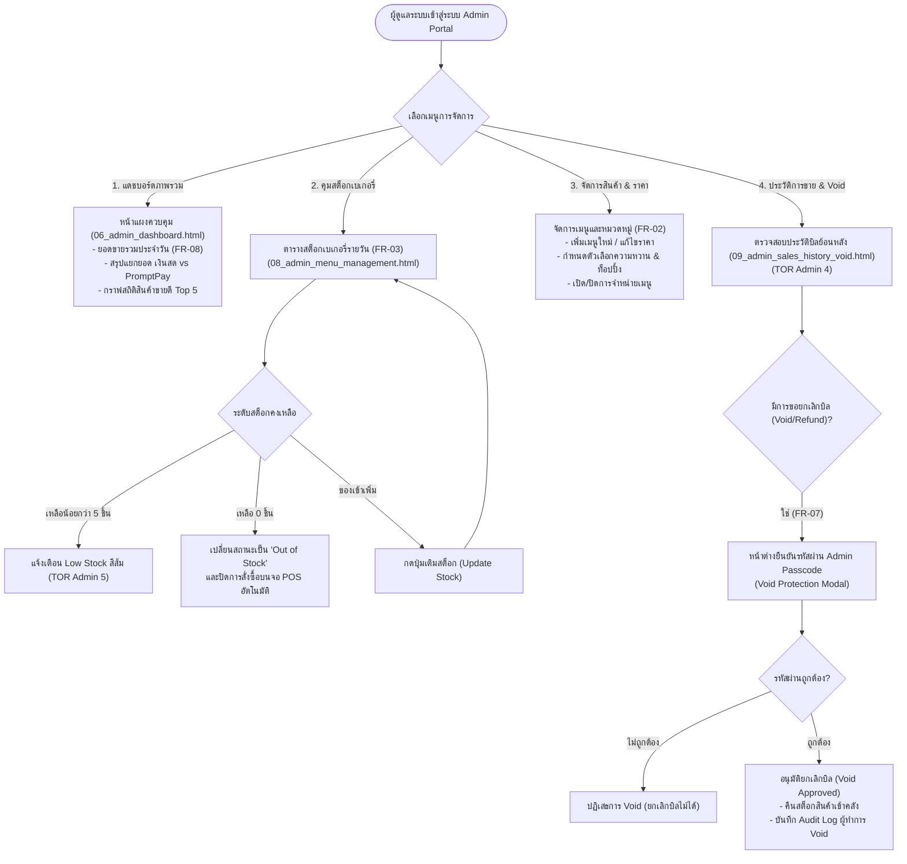
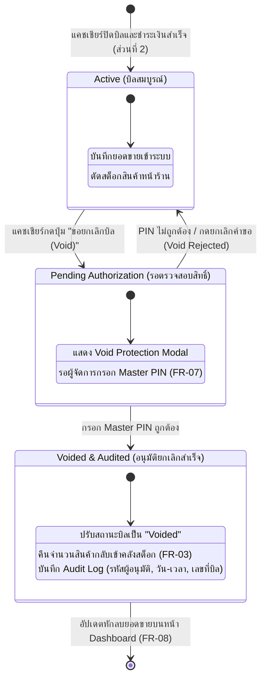

# แผนภาพและขั้นตอนการทำงานระบบผู้ดูแลระบบ (Admin Portal & Audit Diagram)

## ส่วนที่ 4: ระบบแผงควบคุม, สต็อก & ตรวจสอบ Void (Admin Portal, Stock & Audit)

* **ผู้รับผิดชอบ:** นาย ก้องเกียรติ อมรธรรมคุณ (@Kizizi123123)
* **รหัสนิสิต:** 68102010190
* **ข้อกำหนดที่ครอบคลุม:** FR-02, FR-03, FR-07, FR-08, TOR Admin 1-5
* **ไฟล์หน้าจอที่เกี่ยวข้องในโฟลเดอร์นี้:**
  * `06_admin_dashboard.html` (หน้าต่างแผงควบคุมภาพรวม ยอดขาย และกราฟสินค้าขายดี)
  * `08_admin_menu_management.html` (หน้าจัดการเมนูสินค้า ราคา และคลังสต็อกเบเกอรี่)
  * `09_admin_sales_history_void.html` (หน้าประวัติการขายย้อนหลัง และระบบยืนยันสิทธิ์ Void บิล)

---

## 1. แผนภาพ Flowchart การทำงานของระบบผู้ดูแลระบบ (Admin Portal Flowchart)

---

## 2. รายละเอียดขั้นตอนการทำงาน (Flow Breakdown)

| ลำดับ | ส่วนงาน | ขั้นตอน | คำอธิบายการทำงาน | ข้อกำหนด (FR / TOR) |
| --- | --- | --- | --- | --- |
| 1 | Auth / Routing | เข้าสู่ระบบ Admin Portal | ผู้ดูแลระบบ/ผู้จัดการ ยืนยัน Master PIN ผ่านระบบกลาง (ส่วนที่ 1) เพื่อเข้าถึงระบบแผงควบคุม | TOR Admin 1 |
| 2 | Dashboard | สรุปภาพรวมยอดขาย | แสดงผลสรุปยอดขายรวมประจำวันแบบ Real-time พร้อมจำแนกยอดเงินสด และ PromptPay QR Code | FR-08, TOR Admin 2 |
| 3 | Dashboard | สถิติสินค้าขายดี | แสดงชาร์ต/กราฟจัดอันดับสินค้าขายดี 5 อันดับแรก (Top 5 Best Sellers) เพื่อช่วยวางแผนสต็อก | FR-08, TOR Admin 2 |
| 4 | Inventory | ตรวจสอบสต็อกเบเกอรี่ | แสดงตารางสต็อกคงเหลือของเบเกอรี่และของหวานหน้าร้านแบบ Real-time | FR-03, TOR Admin 3 |
| 5 | Inventory | แจ้งเตือน Low Stock | เมื่อสินค้าชนิดใดเหลือต่ำกว่า 5 ชิ้น ระบบจะขึ้นป้ายเตือนสีส้มแจ้งเตือนให้เตรียมเติมของ | TOR Admin 5 |
| 6 | Inventory | ตัดสต็อกหมด (Out of Stock) | เมื่อสินค้าเหลือ 0 ชิ้น ระบบเปลี่ยนสถานะเป็น Out of Stock และส่งสัญญาณล็อกปุ่มบนหน้า POS ทันที | FR-03, TOR Admin 5 |
| 7 | Inventory | อัปเดตเติมสต็อก (Restock) | ผู้จัดการกดปุ่มเพิ่มจำนวนสต็อกเมื่อสินค้าล็อตใหม่มาส่ง พร้อมปลดล็อกปุ่มขายบน POS ให้กลับมาขายได้ | FR-03, TOR Admin 3 |
| 8 | Menu | จัดการเมนูและราคา | เพิ่มเมนูใหม่ ปรับเปลี่ยนราคา จัดหมวดหมู่ และกำหนดเงื่อนไขตัวเลือก (ความหวาน, นม, ท็อปปิ้ง) | FR-02 |
| 9 | Sales History | ตรวจสอบประวัติบิล | เรียกดูรายการบิลขายย้อนหลัง ตรวจสอบรายละเอียดสินค้า เวลาที่ชำระ และช่องทางการจ่ายเงิน | TOR Admin 4 |
| 10 | Void Protection | ตรวจสอบคำขอยกเลิกบิล | เมื่อแคชเชียร์ส่งคำขอ Void บิล ระบบจะเปิดหน้าต่างยืนยัน Master Passcode เพื่อความปลอดภัย | FR-07, TOR Admin 4 |
| 11 | Audit Security | ตรวจสอบรหัสผู้จัดการ | ตรวจสอบรหัส Master PIN หากผิดพลาดจะปฏิเสธการยกเลิกบิลเพื่อป้องกันการทุจริตหน้าร้าน | FR-07 |
| 12 | Audit & Restock | อนุมัติ Void และคืนสต็อก | เมื่อ PIN ถูกต้อง ระบบปรับสถานะบิลเป็น Voided, คืนสต็อกเบเกอรี่เข้าคลัง และบันทึก Audit Log | FR-07, TOR Admin 4 |

---

## 3. แผนภาพ State Machine แสดงการเปลี่ยนสถานะการยกเลิกบิล (Void State Machine)

