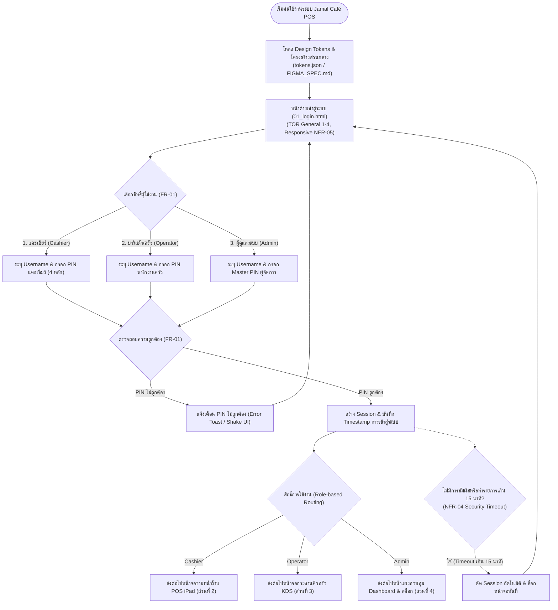
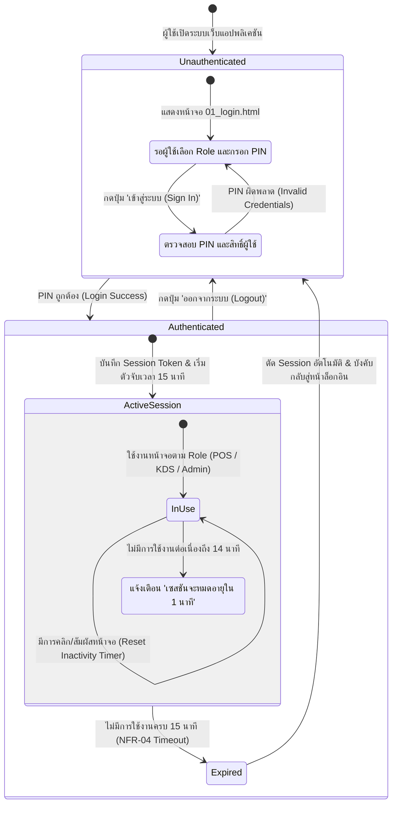

# แผนภาพสถาปัตยกรรมระบบยืนยันตัวตนและการเข้าถึงตามสิทธิ์ (Authentication & Role Redirection Diagram)
## ส่วนที่ 1: ระบบยืนยันตัวตน & โครงสร้างส่วนกลาง (Authentication & Foundations)

* **ผู้รับผิดชอบ:** นาย พิสิษฐ์ เสนีวงศ์ ณ อยุธยา (@AkashiZai)
* **รหัสนิสิต:** 68102010210
* **ข้อกำหนดที่ครอบคลุม:** FR-01 (Authentication & Role-based Access), NFR-04 (15-min Session Timeout), NFR-05 (Responsive & Multi-device), TOR General 1–4
* **ไฟล์หน้าจอและ Asset ที่เกี่ยวข้องในโฟลเดอร์นี้:**
  * `01_login.html` (หน้าจอเข้าสู่ระบบเลือกระดับสิทธิ์และกรอก PIN)
  * `tokens.json` (Design Tokens สี, Spacing, Typography สำหรับ Figma & Web)
  * `FIGMA_SPEC.md` (สเปกโครงสร้างอาร์ตบอร์ดและคอมโพเนนต์ใน Figma)

---

## 1. แผนภาพ Flowchart ระบบยืนยันตัวตนและการกระจายสิทธิ์ (Authentication & Access Flowchart)

---

## 2. รายละเอียดขั้นตอนการทำงาน (Flow Breakdown)

| ลำดับ | ส่วนงาน | ขั้นตอน | คำอธิบายการทำงาน | ข้อกำหนด (FR / NFR / TOR) |
| :--- | :--- | :--- | :--- | :--- |
| **1** | Foundations | **Load Tokens & Spec** | โหลดชุดสี Design Tokens (`tokens.json`), ฟอนต์ Sarabun / Plus Jakarta Sans, และกำหนดขนาดหน้าจอตาม Breakpoints (`FIGMA_SPEC.md`) | NFR-05, TOR General 1, 4 |
| **2** | Login UI | **Render Login Screen** | แสดงหน้าต่างเข้าสู่ระบบ (`01_login.html`) รองรับการแสดงผล Responsive บน iPad, แท็บเล็ต, เดสก์ท็อป และมือถือ | NFR-02, NFR-05, TOR General 3 |
| **3** | Authentication | **Select Role** | ผู้ใช้งานเลือกสิทธิ์ที่ต้องการเข้าใช้งาน: แคชเชียร์ (Cashier), บาริสต้า/ครัว (Operator) หรือ ผู้ดูแลระบบ (Admin) | FR-01, TOR General 2 |
| **4** | Authentication | **Input Credentials & PIN** | กรอกรหัสพนักงาน/Username และรหัสผ่าน หรือ PIN ตัวเลข 4 หลักสำหรับการยืนยันตัวตนหน้าร้านอย่างรวดเร็ว | FR-01 |
| **5** | Security | **Verify Credentials** | ตรวจสอบรหัสผ่านกับฐานข้อมูล หากไม่ถูกต้องจะแสดงข้อความแจ้งเตือนและให้ลองใหม่ | FR-01, TOR General 2 |
| **6** | Session | **Session Creation** | เมื่อรหัสถูกต้อง ระบบจะสร้าง Session Token และบันทึกเวลาเริ่มต้นเพื่อใช้ตรวจสอบ Inactivity Timer | NFR-04 |
| **7** | Routing | **Role-based Redirection** | นำผู้ใช้เข้าสู่หน้าจอที่ได้รับอนุญาต: แคชเชียร์ ➔ POS หน้าร้าน (ส่วนที่ 2), บาริสต้า ➔ กระดาน KDS (ส่วนที่ 3), เจ้าของร้าน ➔ Admin Portal (ส่วนที่ 4) | FR-01, TOR General 2 |
| **8** | Security | **15-Min Auto Logout** | ระบบจะนับเวลาถอยหลัง 15 นาที หากไม่มีการเคลื่อนไหวหรือการกดสัมผัสหน้าจอ จะทำการ Logout และกลับสู่หน้าล็อกอินอัตโนมัติ เพื่อป้องกันการสวมรอย | NFR-04 (Security Timeout) |

---

## 3. แผนภาพ State Machine แสดงวงจรสถานะ Session และ Timeout (Session Lifecycle State Machine)

