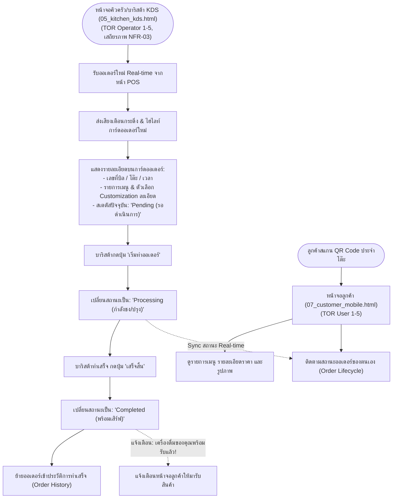
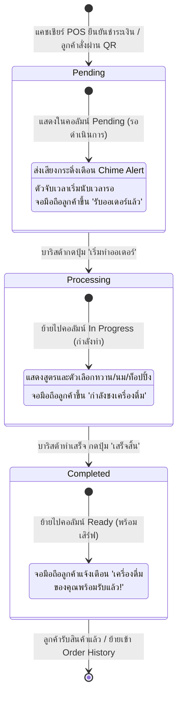

# แผนภาพวงจรชีวิตออเดอร์ (Order Lifecycle Diagram)
## ส่วนที่ 3: ระบบคิวครัว/บาริสต้า & จอลูกค้า (Kitchen KDS & Customer Mobile)

* **ผู้รับผิดชอบ:** นาย พิชยุตม์ เจียวพงษ์พิพัฒน์ (@Ctrl-Pichayut)
* **รหัสนิสิต:** 68102010209
* **ข้อกำหนดที่ครอบคลุม:** TOR Operator 1–5, TOR User 1–5, NFR-03
* **ไฟล์หน้าจอที่เกี่ยวข้องในโฟลเดอร์นี้:**
  * `05_kitchen_kds.html` (หน้าจอคิวครัว/บาริสต้า KDS)
  * `07_customer_mobile.html` (หน้าจอบนมือถือลูกค้า)

---

## 1. แผนภาพ Flowchart วงจรชีวิตออเดอร์ (Order Lifecycle Flowchart)

---

## 2. รายละเอียดขั้นตอนการทำงาน (Flow Breakdown)

| ลำดับ | ส่วนงาน | ขั้นตอน | คำอธิบายการทำงาน | ข้อกำหนด (TOR / NFR) |
| :--- | :--- | :--- | :--- | :--- |
| **1** | KDS | **Receive Order** | รับออเดอร์ใหม่แบบ Real-time ทันทีที่แคชเชียร์ POS ยืนยันชำระเงิน หรือลูกค้าสั่งผ่าน QR | TOR Operator 1, NFR-03 |
| **2** | KDS | **Sound & Highlight** | ส่งเสียงเตือนกระดิ่ง (Chime Alert) พร้อมแสดงเอฟเฟกต์กระพริบ/ไฮไลท์การ์ดออเดอร์ใหม่ | TOR Operator 2 |
| **3** | KDS | **Display Card** | แสดงเลขที่บิล, โต๊ะ, เวลาที่สั่ง, รายการเมนูพร้อม Customization (ระดับความหวาน, ชนิดนม, ท็อปปิ้ง) และสถานะ `Pending` | TOR Operator 3, 4 |
| **4** | Lifecycle | **Action Start** | บาริสต้ากดปุ่ม "เริ่มทำออเดอร์" เพื่อเปลี่ยนสถานะเป็น `Processing (กำลังชง/ปรุง)` | TOR Operator 5 |
| **5** | Lifecycle | **Action Finish** | บาริสต้าทำเครื่องดื่ม/ขนมเสร็จ กดปุ่ม "เสร็จสิ้น" เพื่อเปลี่ยนสถานะเป็น `Completed (พร้อมเสิร์ฟ)` | TOR Operator 5 |
| **6** | Lifecycle | **Move History** | ย้ายออเดอร์ที่เสร็จแล้วเข้าสู่แท็บ Order History พร้อมบันทึกเวลาที่ทำสำเร็จ | TOR Operator 5 |
| **7** | Mobile | **Customer View** | ลูกค้าสแกน QR Code ประจำโต๊ะ เปิดหน้าจอบนมือถือ ดูเมนู ราคา รูปภาพ และติดตามสถานะออเดอร์ | TOR User 1, 2, 3 |
| **8** | Sync | **Real-time Sync** | สถานะจากหน้าจอ KDS ถูก Sync ไปยังมือถือลูกค้าแบบทันที (Pending → Processing → Completed) | TOR User 4, NFR-03 |
| **9** | Sync | **Customer Alert** | เมื่อ KDS เปลี่ยนเป็น `Completed` ระบบแจ้งเตือนบนจอมือถือลูกค้า "เครื่องดื่มของคุณพร้อมรับแล้ว!" | TOR User 5 |

---

## 3. แผนภาพ State Machine แสดงการเปลี่ยนสถานะ (Order State Machine)

