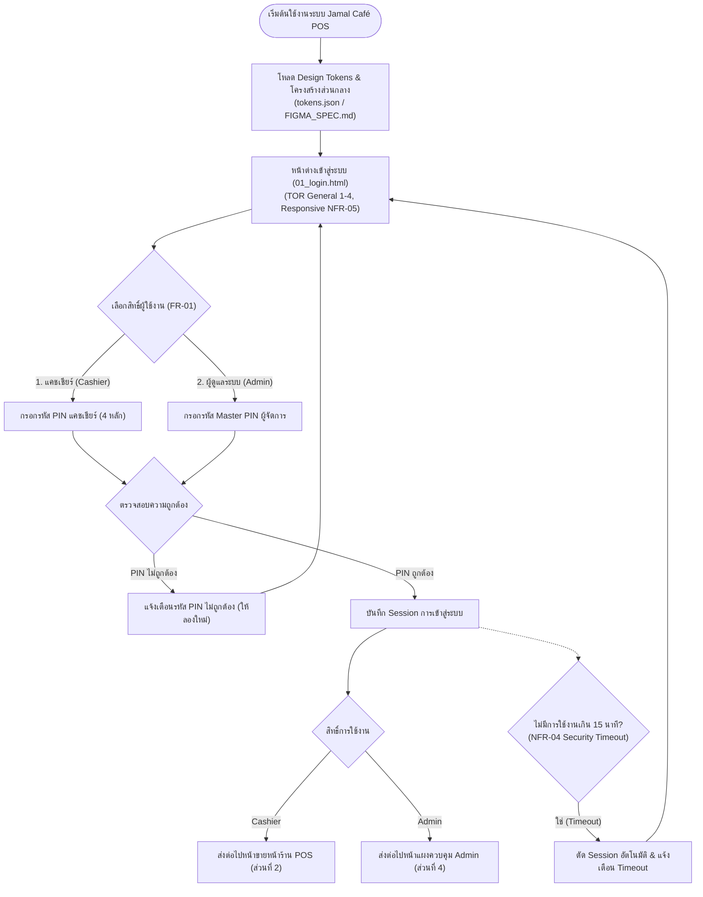
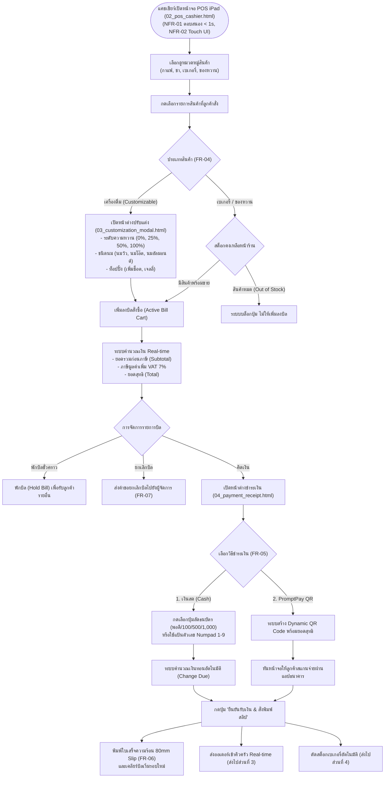
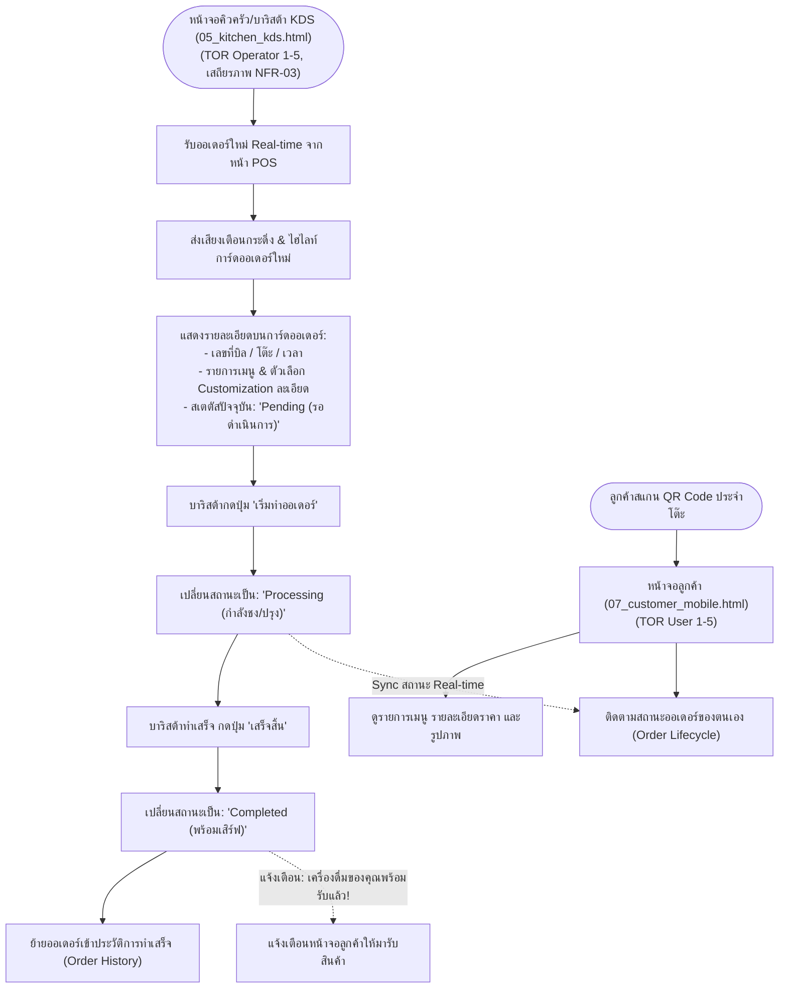
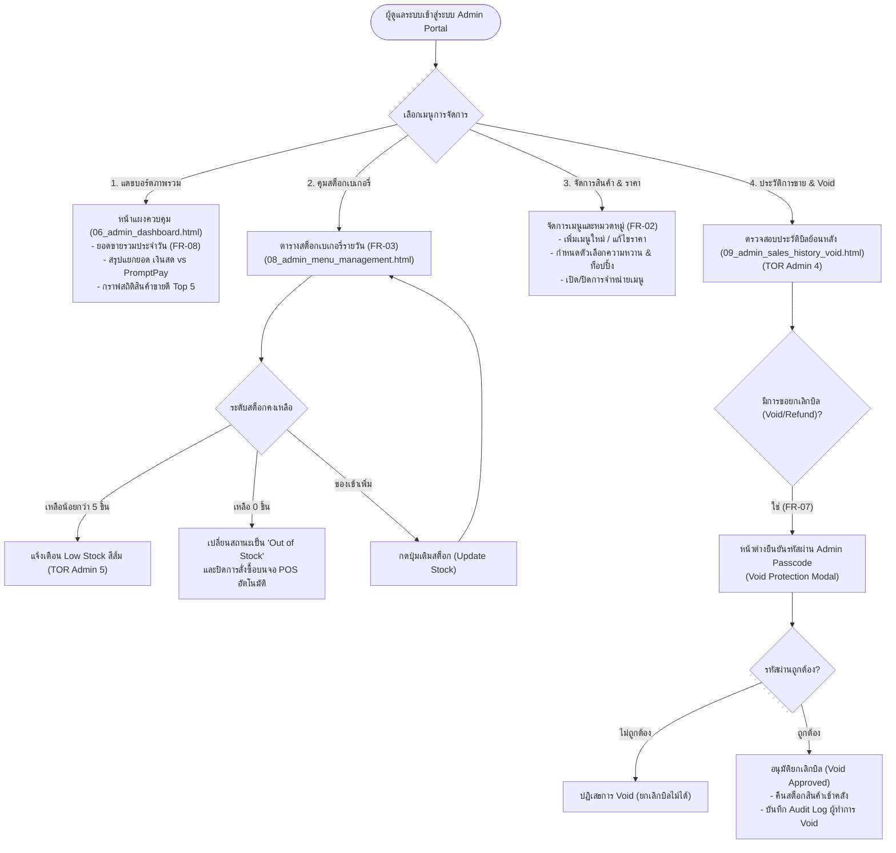
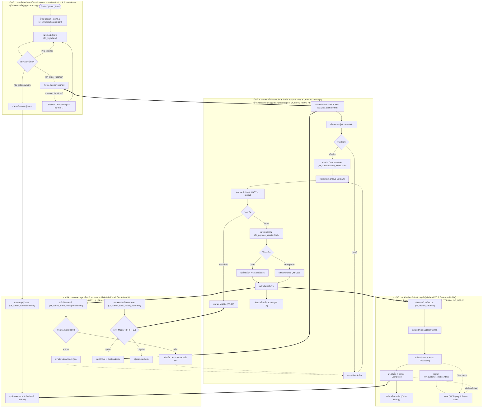

# แผนผังกระบวนการทำงานของระบบ POS (System Workflow Flowchart)
### ตามการแบ่งส่วนงาน 4 ส่วน (Jamal Café & Bakery POS)

เอกสารนี้รวบรวม Flowchart ของระบบ **Jamal Café & Bakery Web POS** โดยแบ่งโครงสร้างตามส่วนงานและผู้รับผิดชอบ 4 ส่วนอย่างชัดเจน พร้อมโค้ด Mermaid ที่สามารถคัดลอกไปใช้งานบน **[Mermaid Live Editor](https://mermaid.live)** หรือแสดงผลบน **GitHub Markdown** ได้ทันที

---

## 1. ตารางการแบ่งส่วนงานและความรับผิดชอบ (Work Breakdown Structure)

| ส่วนที่ | ชื่อส่วนงาน (Module) | ผู้รับผิดชอบ (สมาชิก) | ข้อกำหนดที่รับผิดชอบ | หน้าจอที่ส่งมอบ (Screens & Assets) |
| :---: | :--- | :--- | :--- | :--- |
| **ส่วนที่ 1** | **ระบบยืนยันตัวตน & โครงสร้างส่วนกลาง** (Authentication & Foundations) | นาย พิสิษฐ์ เสณีวงศ์ ณ อยุธยา (`@AkashiZai`) | FR-01, NFR-04, NFR-05, TOR General 1-4 | • `01_login.html` • `tokens.json` • `FIGMA_SPEC.md` |
| **ส่วนที่ 2** | **ระบบขายหน้าร้านแคชเชียร์ & คิดเงิน** (Cashier POS & Checkout / Receipt) | นาย ธราเทพ ศรีมานนท์ (`@203Tharathep`) | FR-04, FR-05, FR-06, NFR-01, NFR-02 (iPad POS) | • `02_pos_cashier.html` • `03_customization_modal.html` • `04_payment_receipt.html` |
| **ส่วนที่ 3** | **ระบบคิวครัว/บาริสต้า & จอลูกค้า** (Kitchen KDS & Customer Mobile) | นาย พิชยุตม์ เจียวพงษ์พิพัฒน์ (`@Ctrl-Pichayut`) | TOR Operator 1-5, TOR User 1-5, NFR-03 | • `05_kitchen_kds.html` • `07_customer_mobile.html` • แผนภาพ Order Lifecycle |
| **ส่วนที่ 4** | **ระบบแผงควบคุม, สต็อก & ตรวจสอบ Void** (Admin Portal, Stock & Audit) | นาย ก้องเกียรติ อมรธรรมคุณ (`@Kizizi123123`) | FR-02, FR-03, FR-07, FR-08, TOR Admin 1-5 | • `06_admin_dashboard.html` • `08_admin_menu_management.html` • `09_admin_sales_history_void.html` |

---

## 2. ส่วนที่ 1: ระบบยืนยันตัวตน & โครงสร้างส่วนกลาง (Authentication & Foundations)
- **ผู้รับผิดชอบ:** นาย พิสิษฐ์ เสณีวงศ์ ณ อยุธยา (`@AkashiZai`)
- **ข้อกำหนด:** FR-01 (Authentication), NFR-04 (15-min Session Timeout), NFR-05 (Responsive), TOR General 1-4
- **สิ่งที่ส่งมอบ:** `01_login.html`, `tokens.json`, `FIGMA_SPEC.md`

---

## 3. ส่วนที่ 2: ระบบขายหน้าร้านแคชเชียร์ & คิดเงิน (Cashier POS & Checkout / Receipt)
- **ผู้รับผิดชอบ:** นาย ธราเทพ ศรีมานนท์ (`@203Tharathep`)
- **ข้อกำหนด:** FR-04 (Order Processing), FR-05 (Payment Calculation), FR-06 (80mm Slip), NFR-01 (Speed <1s), NFR-02 (Touchscreen UI)
- **สิ่งที่ส่งมอบ:** `02_pos_cashier.html`, `03_customization_modal.html`, `04_payment_receipt.html`

---

## 4. ส่วนที่ 3: ระบบคิวครัว/บาริสต้า & จอลูกค้า (Kitchen KDS & Customer Mobile)
- **ผู้รับผิดชอบ:** นาย พิชยุตม์ เจียวพงษ์พิพัฒน์ (`@Ctrl-Pichayut`)
- **ข้อกำหนด:** TOR Operator 1-5 (Real-time KDS, สถานะงาน, เสียงเตือน), TOR User 1-5 (จอลูกค้ามือถือ), NFR-03 (ความเสถียร)
- **สิ่งที่ส่งมอบ:** `05_kitchen_kds.html`, `07_customer_mobile.html`, แผนภาพ Order Lifecycle

---

## 5. ส่วนที่ 4: ระบบแผงควบคุม, สต็อก & ตรวจสอบ Void (Admin Portal, Stock & Audit)
- **ผู้รับผิดชอบ:** นาย ก้องเกียรติ อมรธรรมคุณ (`@Kizizi123123`)
- **ข้อกำหนด:** FR-02 (จัดการเมนู), FR-03 (ตัดสต็อกอัตโนมัติ), FR-07 (ระบบอนุมัติ Void), FR-08 (รายงานยอดขาย), TOR Admin 1-5
- **สิ่งที่ส่งมอบ:** `06_admin_dashboard.html`, `08_admin_menu_management.html`, `09_admin_sales_history_void.html`

---

## 6. แผนผังภาพรวมทั้งระบบ (All-in-One Integrated Flowchart)
แผนผังนี้แสดงการเชื่อมต่อข้ามระหว่างทั้ง 4 ส่วนงานเมื่อทำงานร่วมกันในระบบจริง:

---

## 7. คำแนะนำในการใช้งาน
1. **ดูบน GitHub:** ไฟล์ Markdown นี้รองรับการ Render Mermaid Diagram เป็นภาพกราฟิกบน GitHub โดยอัตโนมัติ
2. **แก้ไขบน Mermaid Live:** คัดลอกบล็อกโค้ดในหัวข้อที่ต้องการ แล้วนำไปวางที่ [https://mermaid.live](https://mermaid.live) เพื่อดาวน์โหลดเป็นไฟล์ SVG หรือ PNG คมชัดสูงได้ทันที
