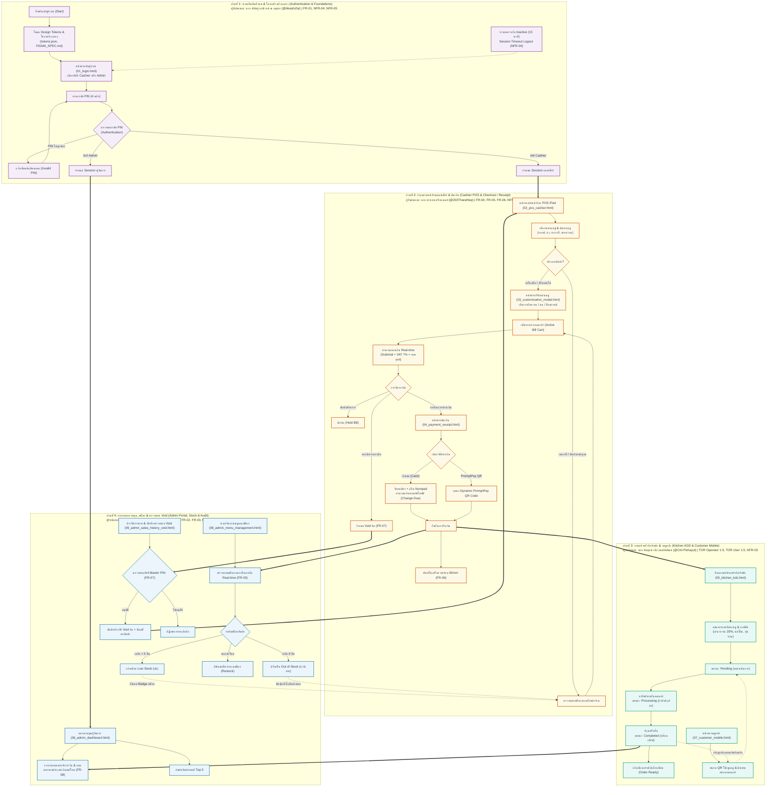

# แผนผังกระบวนการทำงานของระบบ POS (System Workflow Flowchart)
### ตามการแบ่งส่วนงาน 4 ส่วน (Jamal Café & Bakery POS)

อ้างอิงตามโครงสร้างการแบ่งงานของสมาชิกในกลุ่ม:

| ส่วนที่ | ชื่อส่วนงาน (Module) | ผู้รับผิดชอบ | ข้อกำหนดที่รับผิดชอบ | หน้าจอที่ส่งมอบ (Screens & Assets) |
| :---: | :--- | :--- | :--- | :--- |
| **ส่วนที่ 1** | **ระบบยืนยันตัวตน & โครงสร้างส่วนกลาง** (Authentication & Foundations) | นาย พิสิษฐ์ เสณีวงศ์ ณ อยุธยา (`@AkashiZai`) | FR-01, NFR-04, NFR-05, TOR General 1-4 | • `01_login.html` • `tokens.json` • `FIGMA_SPEC.md` |
| **ส่วนที่ 2** | **ระบบขายหน้าร้านแคชเชียร์ & คิดเงิน** (Cashier POS & Checkout / Receipt) | นาย ธราเทพ ศรีมานนท์ (`@203Tharathep`) | FR-04, FR-05, FR-06, NFR-01, NFR-02 (iPad POS) | • `02_pos_cashier.html` • `03_customization_modal.html` • `04_payment_receipt.html` |
| **ส่วนที่ 3** | **ระบบคิวครัว/บาริสต้า & จอลูกค้า** (Kitchen KDS & Customer Mobile) | นาย พิชยุตม์ เจียวพงษ์พิพัฒน์ (`@Ctrl-Pichayut`) | TOR Operator 1-5, TOR User 1-5, NFR-03 | • `05_kitchen_kds.html` • `07_customer_mobile.html` • แผนภาพ Order Lifecycle |
| **ส่วนที่ 4** | **ระบบแผงควบคุม, สต็อก & ตรวจสอบ Void** (Admin Portal, Stock & Audit) | นาย ก้องเกียรติ อมรธรรมคุณ (`@Kizizi123123`) | FR-02, FR-03, FR-07, FR-08, TOR Admin 1-5 | • `06_admin_dashboard.html` • `08_admin_menu_management.html` • `09_admin_sales_history_void.html` |

---

## Mermaid Flowchart (พร้อมใช้งานบน Mermaid Live Editor)

