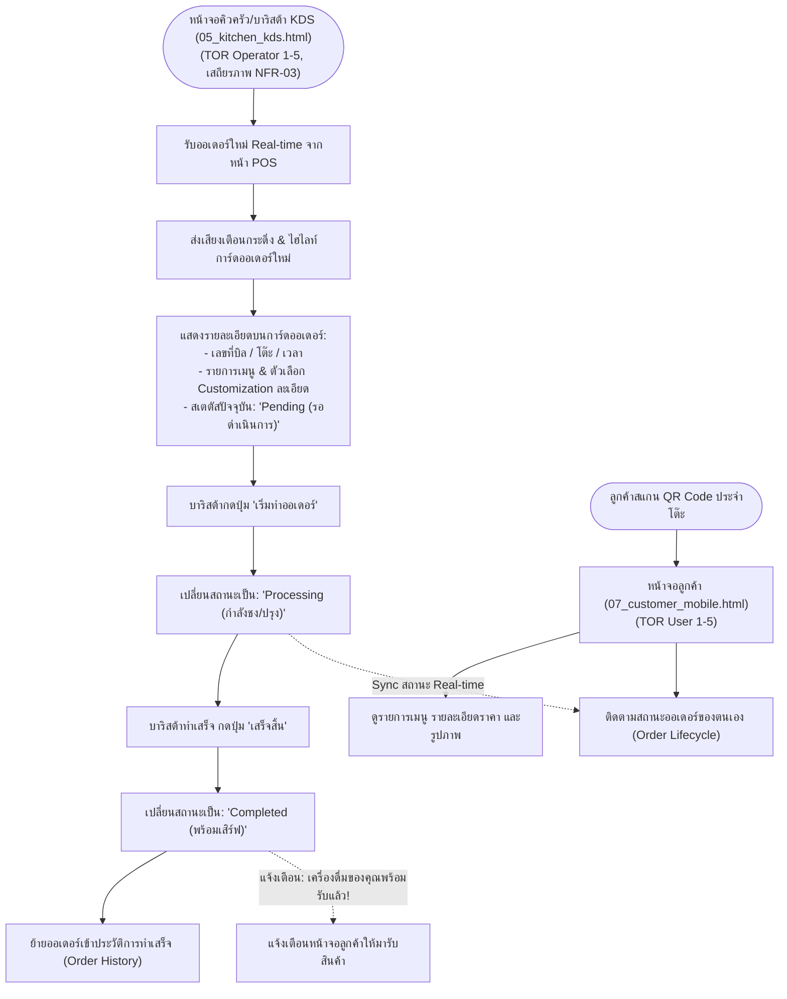
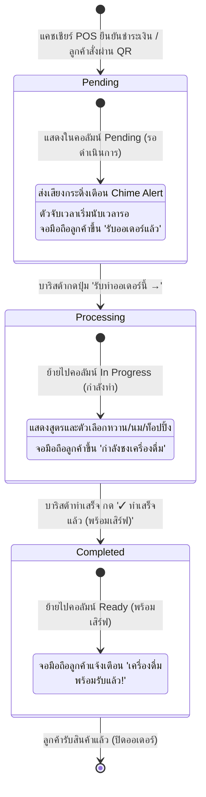
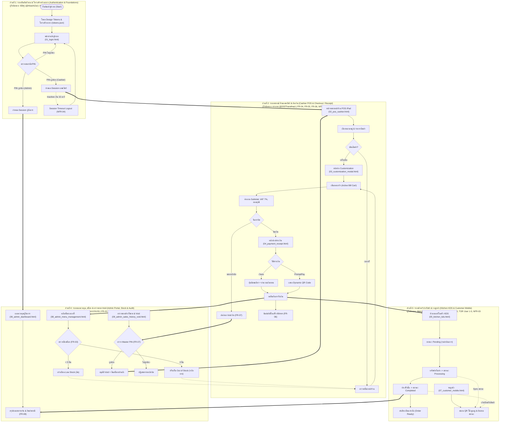

# แผนภาพวงจรชีวิตออเดอร์ (Order Lifecycle Diagram)
## ส่วนที่ 3: ระบบคิวครัว/บาริสต้า & จอลูกค้า (Kitchen KDS & Customer Mobile)

* **ผู้รับผิดชอบ:** นาย พิชยุตม์ เจียวพงษ์พิพัฒน์ (@Ctrl-Pichayut)
* **รหัสนิสิต:** 68102010209
* **ข้อกำหนดที่ครอบคลุม:** TOR Operator 1–5, TOR User 1–5, NFR-03
* **ไฟล์หน้าจอที่เกี่ยวข้องในโฟลเดอร์นี้:**
  * `05_kitchen_kds.html` (หน้าจอคิวครัว/บาริสต้า KDS)
  * `07_customer_mobile.html` (หน้าจอบนมือถือลูกค้า)

---

## 1. แผนภาพ Flowchart วงจรชีวิตออเดอร์ ส่วนที่ 3 (Order Lifecycle Flowchart)

---

## 2. แผนภาพ State Machine แสดงการเปลี่ยนผ่านสถานะ (Order State Machine)

---

## 3. โค้ดรวมทั้งระบบแบบบูรณาการ 4 ส่วนงาน (All-in-One Integrated Flowchart)

โค้ดสำหรับนำไปเปิดใน [Mermaid Live Editor](https://mermaid.live/) หรือดูบน GitHub เพื่อแสดงการทำงานข้ามกันทั้ง 4 โมดูล:

